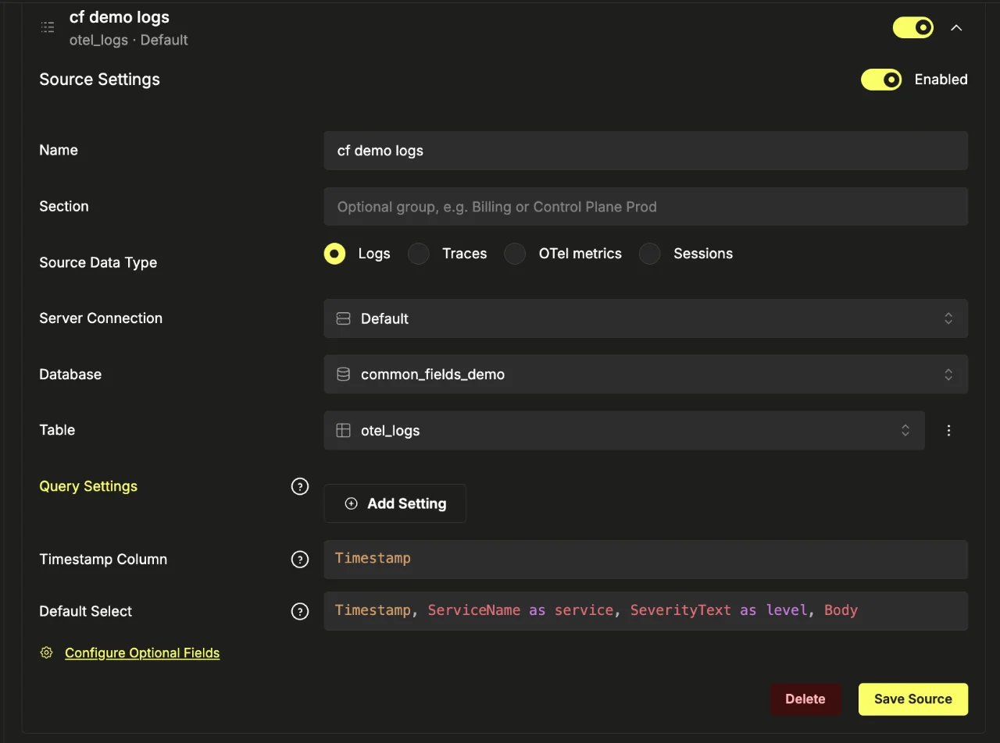
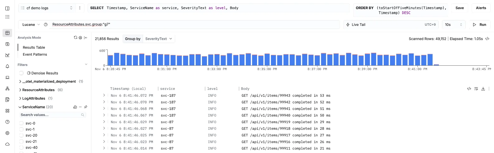
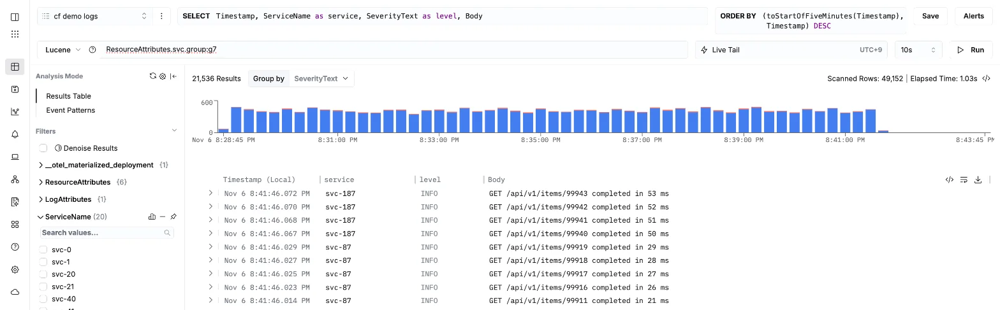
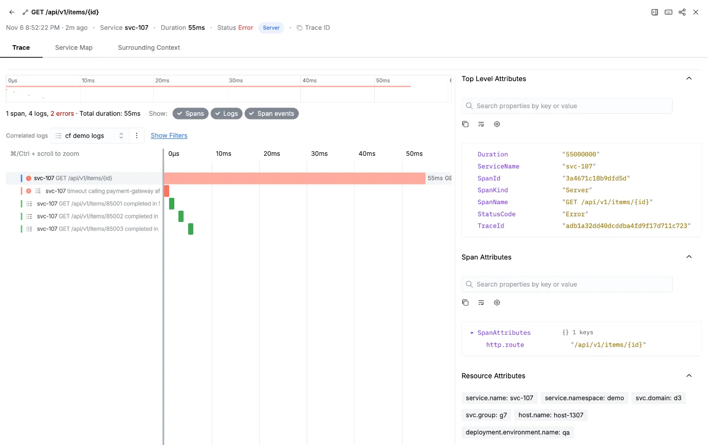

# Common fields: one taxonomy across apps, hosts and ClickStack

[English](#english) | [한국어](#한국어)

## English

A fleet is searched by the same few fields every time: which service domain and group, which
host, which environment. This lab is the adoption guide for those fields — where each one is
set, how the collector normalises the names, and the ClickStack tables that keep them fast —
with the configs as files and every piece checked.

> **Verified on:** `schema/schema.sql` in `clickhouse local` 26.9.6.6 (`tests/test_schema.py`:
> every table created, the columns fill, a filter on them uses the primary key; the negative checks
> and the injected fault in [Tests](#tests)), 2026-11-07, and on ClickHouse Cloud 26.8.1.608 with
> Managed ClickStack (`managed/demo.py`, the screens below), 2026-11-07.
> `collector/standard-fields.yaml` in otelcol-contrib 0.155.0 (`tests/test_collector.sh`: the
> rename, its precedence, the negative check and the injected fault), 2026-11-07. The read-volume numbers come from
> [`labs/hostmetrics-volume`](../hostmetrics-volume/README.md) (logs and gauge metrics, settled
> run, 2026-11-06). Traces and the other metric types follow the same rule and were not measured.

### The fields

| Field | What | Set by |
|---|---|---|
| `svc.domain`, `svc.group` | your service taxonomy, two levels (rename to your own keys) | apps: `OTEL_RESOURCE_ATTRIBUTES`; hosts: EC2 tags `svc.domain` / `svc.group` |
| `service.namespace`, `service.name` | project and service | apps: `OTEL_RESOURCE_ATTRIBUTES`, `OTEL_SERVICE_NAME` |
| `host.name` | the machine | the collector's `resourcedetection` (`system`, `ec2`) |
| `deployment.environment.name` | `qa` / `live` | apps: `OTEL_RESOURCE_ATTRIBUTES`; hosts: the agent's `resource` processor |
| `service.version` | the deployed version | apps: `OTEL_RESOURCE_ATTRIBUTES` (from the build) |

All are **resource attributes**: they describe who sent the data, so they are the same on every
span, log line and metric point of that process, and they land in the `ResourceAttributes`
column. Keep the standard to these few; everything else stays free-form in the attribute maps —
slower to filter, still searchable.

### 1. Apps (development teams)

No code change: the OpenTelemetry SDKs and agents read two environment variables.

```bash
OTEL_SERVICE_NAME=checkout-api
OTEL_RESOURCE_ATTRIBUTES=service.namespace=shop,svc.domain=commerce,svc.group=payments,deployment.environment.name=qa,service.version=1.4.2
OTEL_EXPORTER_OTLP_ENDPOINT=http://<gateway NLB>:4318
```

- **Java agent** (`-javaagent:opentelemetry-javaagent.jar`): the same variables, or the
  `-Dotel.service.name` / `-Dotel.resource.attributes` system properties. Logs from Logback and
  Log4j are exported with the trace and span id of the request that wrote them, so a trace in
  ClickStack shows its log lines.
- **Kubernetes**: set the two variables in the Deployment's `env`; take `service.version` from the
  image tag at build time.
- Values must not contain commas or `=`; URL-encode them if they do.

### 2. Hosts (infrastructure)

Tag each instance where it is launched (launch template, Auto Scaling group, Terraform) with
`svc.domain` and `svc.group`. The host agent reads the tags; nothing is typed into a config file
per host.

```yaml
processors:
  resourcedetection:
    detectors: [env, system, ec2]
    ec2:
      tags: ['^svc\.']        # -> ec2.tag.svc.domain, ec2.tag.svc.group
```

The instance role needs `ec2:DescribeTags`. The Windows profile
[`otel-profiles/profiles/windows-host`](../../otel-profiles/profiles/windows-host/) already does
this (`WINDOWS_HOST_EC2_TAGS`).

### 3. Gateway: one place for the names

[`collector/standard-fields.yaml`](collector/standard-fields.yaml) merges into the gateway
collector's config. It renames `ec2.tag.svc.domain` / `ec2.tag.svc.group` to `svc.domain` /
`svc.group`, keeps a value an app set itself, removes the `ec2.tag.svc.*` keys, and sets
`create_schema: false` on the ClickHouse exporter with the table names of step 4. Doing it at the
gateway means the key names are fixed in one file, not on 4,000 hosts.

```bash
otelcol-contrib --config gateway.yaml --config standard-fields.yaml
```

### 4. ClickHouse: the fields as columns, in the sort key

[`schema/schema.sql`](schema/schema.sql) is the ClickHouse exporter's own DDL
(opentelemetry-collector-contrib v0.155.0) with three changes:

1. `svc_domain`, `svc_group`, `host` are `MATERIALIZED` columns from `ResourceAttributes`, each
   with a skip index.
2. The sort key leads with the field fleet queries filter on most: logs and traces
   `(svc_group, ServiceName, …)`, metrics `(ServiceName, MetricName, svc_group, host, …)`.
3. A 30-day TTL — set each table to your retention.

```bash
clickhouse client --database otel --multiquery < schema/schema.sql
```

Apply it into an empty database before the first export. ClickStack needs no change: a search on
the map key (`svc.group:"payments"`) is rewritten to the column.

What it buys, measured on ClickHouse Cloud 26.8.1.608 with synthetic data the size of 4,000 hosts
([`labs/hostmetrics-volume`](../hostmetrics-volume/README.md), 2026-11-06, settled tables):

| Query | Exporter default | This schema |
|---|---|---|
| One host, one metric | 254 K rows · 5.7 MiB | 8 K rows · 0.12 MiB |
| One host, every metric | 16.8 M rows · 188 MiB · 572 ms | 1.1 M rows · 3.3 MiB · 16 ms |
| One group's ERROR logs (10 M rows) | 1.78 M rows · 290 ms | 0.53 M rows · 17 ms |
| Storage, metrics | 41.3 MiB | 41.6 MiB |

### 5. In ClickStack: one source per table, exact match in searches

Point a ClickStack source at each table, as for the defaults. Nothing else changes: ClickStack
finds the materialized column and rewrites a search on the map key to it.



On the demo (ClickHouse Cloud 26.8.1.608, 2026-11-07; 2 M log rows an hour, 200 services in 20
groups), `ResourceAttributes.svc.group:"g7"` over 15 minutes became `svc_group = 'g7'` and read 49,152 rows — six granules — for 24,836
results:



Without quotes, `svc.group:g7` is a **substring** match ("contains"), sent as
`svc_group ILIKE '%g7%'`. On this schema it read the same 49,152 rows, because the column's set
index can test each granule's values; on the bench's tables, which had the column without that
index, a substring search read all 10 M rows. Write saved searches, alerts and dashboard filters
on the common fields as exact matches anyway: a substring also matches every value that contains
it (`pay` matches `payments` and `paypal`), and it is the index, not the search, that kept it cheap.



The same fields tie the signals together. Searching the trace source for
`ResourceAttributes.svc.group:"g7" StatusCode:"Error"` and opening a span shows its log lines on
the same timeline (the trace source is linked to the log source; the logs carry the span's trace
id) and the common fields under Resource Attributes:



Screens: Managed ClickStack on ClickHouse Cloud 26.8.1.608, Seoul, 2026-11-07, `managed/demo.py`,
the 15 minutes 12:39–12:54 KST. Rows read are the screen's Scanned Rows; on the 2026-11-06 run
(HyperDX 2.42.0) `system.query_log` showed the same 49,152.

### Run the demo on Managed ClickStack

```bash
python3 managed/demo.py      # database common_fields_demo, schema.sql, synthetic data, 3 linked sources
python3 managed/demo.py --cleanup
```

Reads `~/.config/khai-harness/secrets/clickhouse-seoul.env` (`CH_HOST`, `CH_USER`,
`CH_PASSWORD`) and `chc-api.env` (`CHC_KEY`, `CHC_SECRET`) by default; `--ch-env` / `--api-env`
point elsewhere.

### Tests

```bash
python3 -m unittest discover -s tests     # schema.sql in clickhouse local (skipped without the binary)
tests/test_collector.sh                    # standard-fields.yaml in otelcol-contrib 0.155.0 (Docker)
```

Each test has a positive check, a negative check and a fault it injects into a copy of the file
and must catch (2026-11-07, `clickhouse local` 26.9.6.6 · otelcol-contrib 0.155.0: 5/5 tests,
6/6 checks, both faults caught):

| Test | Positive | Negative | Injected fault |
|---|---|---|---|
| `test_schema.py` | `svc_group = 'g7'` (logs) and `svc_group` + `host` (gauge) prune primary-key granules | `ResourceAttributes['svc.group'] = 'g7'` does not use the primary key (ClickHouse does not rewrite the map lookup; ClickStack's search does); a row without `svc.*` gets `''` | `svc_group` dropped from the logs sort key: the pruning check fails |
| `test_collector.sh` | EC2 tags become `svc.domain` / `svc.group`; an app's own `svc.group` is kept; `ec2.tag.svc.*` removed | a log with neither tags nor `svc.*` gets no `svc.*` key | the `svc.group` rule without its "app value first" guard: "app: its own svc.group kept" fails |

## 한국어

플릿을 조회할 때는 매번 같은 몇 개 필드로 거릅니다. 어느 서비스 도메인·그룹인지, 어느 호스트인지,
어느 환경인지입니다. 이 실습은 그 필드의 적용 가이드입니다. 각 필드를 어디서 넣는지, Collector가
이름을 어떻게 맞추는지, 그 필드로 빠르게 조회되는 ClickStack 테이블은 어떻게 만드는지를 설정 파일로
두고, 하나씩 확인했습니다.

> **검증:** `schema/schema.sql`은 `clickhouse local` 26.9.6.6(`tests/test_schema.py`: 테이블이 모두
> 만들어지고, 컬럼이 채워지고, 그 컬럼 조건이 primary key를 씀. 반대 확인과 일부러 넣은 오류는
> [테스트](#테스트) 참고)에서 2026-11-07, ClickHouse Cloud 26.8.1.608의 Managed ClickStack(`managed/demo.py`,
> 아래 화면)에서 2026-11-07. `collector/standard-fields.yaml`은 otelcol-contrib 0.155.0(`tests/test_collector.sh`:
> 이름 바꾸기, 우선순위, 반대 확인, 일부러 넣은 오류), 2026-11-07. 읽는 양
> 수치는 [`labs/hostmetrics-volume`](../hostmetrics-volume/README.md)(로그와 gauge 메트릭, 병합이 끝난
> 뒤 실행, 2026-11-06)에서 왔습니다. trace와 나머지 메트릭 종류는 같은 원칙을 따르지만 재지 않았습니다.

### 필드

| 필드 | 무엇 | 넣는 곳 |
|---|---|---|
| `svc.domain`, `svc.group` | 서비스 분류 2단계(자사 키 이름으로 바꿔 씀) | 앱: `OTEL_RESOURCE_ATTRIBUTES`, 호스트: EC2 태그 `svc.domain` / `svc.group` |
| `service.namespace`, `service.name` | 프로젝트와 서비스 | 앱: `OTEL_RESOURCE_ATTRIBUTES`, `OTEL_SERVICE_NAME` |
| `host.name` | 머신 | Collector의 `resourcedetection`(`system`, `ec2`) |
| `deployment.environment.name` | `qa` / `live` | 앱: `OTEL_RESOURCE_ATTRIBUTES`, 호스트: agent의 `resource` processor |
| `service.version` | 배포 버전 | 앱: `OTEL_RESOURCE_ATTRIBUTES`(빌드에서) |

모두 **resource attribute**입니다. 데이터를 보낸 주체를 설명하므로 그 프로세스의 모든 span, 로그 줄,
메트릭 point에 똑같이 붙고, `ResourceAttributes` 컬럼에 들어갑니다. 표준은 이 몇 개로 둡니다. 나머지는 attribute map에 자유롭게 둡니다. 거를 때 느릴 뿐 검색은 됩니다.

### 1. 앱(개발팀)

코드 수정은 없습니다. OpenTelemetry SDK와 agent가 환경 변수 두 개를 읽습니다.

```bash
OTEL_SERVICE_NAME=checkout-api
OTEL_RESOURCE_ATTRIBUTES=service.namespace=shop,svc.domain=commerce,svc.group=payments,deployment.environment.name=qa,service.version=1.4.2
OTEL_EXPORTER_OTLP_ENDPOINT=http://<gateway NLB>:4318
```

- **Java agent**(`-javaagent:opentelemetry-javaagent.jar`): 같은 환경 변수, 또는 `-Dotel.service.name` /
  `-Dotel.resource.attributes` 시스템 속성. Logback·Log4j 로그는 그 로그를 쓴 요청의 trace ID·span ID와
  함께 내보내지므로, ClickStack의 trace 화면에 그 로그 줄이 함께 보입니다.
- **Kubernetes**: Deployment의 `env`에 두 변수를 넣습니다. `service.version`은 빌드할 때 이미지 태그에서
  가져옵니다.
- 값에 쉼표나 `=`가 있으면 안 됩니다. 있으면 URL 인코딩합니다.

### 2. 호스트(인프라)

인스턴스를 띄우는 곳(launch template, Auto Scaling 그룹, Terraform)에서 `svc.domain`, `svc.group` 태그를
붙입니다. 호스트 agent가 태그를 읽으므로, 호스트마다 설정 파일에 적을 것이 없습니다.

```yaml
processors:
  resourcedetection:
    detectors: [env, system, ec2]
    ec2:
      tags: ['^svc\.']        # -> ec2.tag.svc.domain, ec2.tag.svc.group
```

인스턴스 역할에 `ec2:DescribeTags`가 필요합니다. Windows 프로필
[`otel-profiles/profiles/windows-host`](../../otel-profiles/profiles/windows-host/)는 이미 이렇게
합니다(`WINDOWS_HOST_EC2_TAGS`).

### 3. Gateway: 이름은 한 곳에서

[`collector/standard-fields.yaml`](collector/standard-fields.yaml)을 gateway Collector 설정에 합칩니다.
`ec2.tag.svc.domain` / `ec2.tag.svc.group`을 `svc.domain` / `svc.group`으로 바꾸고, 앱이 직접 넣은 값은
그대로 두고, `ec2.tag.svc.*` 키는 지웁니다. ClickHouse exporter에는 `create_schema: false`와 4단계의
테이블 이름을 줍니다. gateway에서 하므로 키 이름은 4,000대가 아니라 파일 하나에서 정해집니다.

```bash
otelcol-contrib --config gateway.yaml --config standard-fields.yaml
```

### 4. ClickHouse: 필드를 컬럼으로, 정렬 키에

[`schema/schema.sql`](schema/schema.sql)은 ClickHouse exporter 자신의 DDL(opentelemetry-collector-contrib
v0.155.0)에서 세 가지만 바꾼 것입니다.

1. `svc_domain`, `svc_group`, `host`를 `ResourceAttributes`에서 `MATERIALIZED` 컬럼으로 만들고, 각각
   skip index를 겁니다.
2. 정렬 키 앞쪽에 플릿 조회가 가장 많이 거르는 필드를 둡니다. 로그와 trace는 `(svc_group, ServiceName, …)`,
   메트릭은 `(ServiceName, MetricName, svc_group, host, …)`입니다.
3. 30일 TTL. 테이블마다 보관 기간에 맞춰 바꿉니다.

```bash
clickhouse client --database otel --multiquery < schema/schema.sql
```

첫 전송 전에 빈 데이터베이스에 적용합니다. ClickStack은 바꿀 것이 없습니다. map 키 검색
(`svc.group:"payments"`)을 그 컬럼으로 바꿔 씁니다.

효과는 4,000대 규모의 합성 데이터로 ClickHouse Cloud 26.8.1.608에서 쟀습니다([`labs/hostmetrics-volume`](../hostmetrics-volume/README.md),
2026-11-06, 병합이 끝난 테이블).

| 조회 | exporter 기본 | 이 스키마 |
|---|---|---|
| 호스트 1대, 메트릭 1종 | 25.4만 행 · 5.7 MiB | 8,192행 · 0.12 MiB |
| 호스트 1대, 전체 메트릭 | 1,680만 행 · 188 MiB · 572 ms | 114만 행 · 3.3 MiB · 16 ms |
| 그룹 1개의 ERROR 로그(1,000만 행) | 178만 행 · 290 ms | 53만 행 · 17 ms |
| 저장, 메트릭 | 41.3 MiB | 41.6 MiB |

### 5. ClickStack에서: 테이블마다 소스 하나, 검색은 정확 일치로

기본 테이블처럼 테이블마다 ClickStack 소스를 하나씩 연결합니다. 그 밖에 바꿀 것은 없습니다. ClickStack이
materialized 컬럼을 찾아 map 키 검색을 그 컬럼으로 바꿔 씁니다.


데모(ClickHouse Cloud 26.8.1.608, 2026-11-07. 시간당 로그 200만 행, 서비스 200개·그룹 20개)에서 15분 구간의 `ResourceAttributes.svc.group:"g7"`은
`svc_group = 'g7'`으로 바뀌었고, granule 여섯 개인 49,152행을 읽어 결과 24,836건을 냈습니다.


따옴표가 없는 `svc.group:g7`은 **부분 일치**("contains")로, `svc_group ILIKE '%g7%'`로 나갑니다. 이 스키마에서는
같은 49,152행을 읽었습니다. 컬럼의 set 인덱스가 granule마다 값을 확인할 수 있기 때문입니다. 그 인덱스 없이
컬럼만 있던 벤치 테이블에서는 부분 일치 검색이 1,000만 행을 다 읽었습니다. 그래도 공통 필드로 거는 저장 검색,
알림, 대시보드 필터는 정확 일치로 씁니다. 부분 일치는 그 문자열을 포함한 값을 모두 잡고(`pay`는 `payments`와
`paypal`을 모두 잡음), 읽는 양을 줄인 것은 검색 방식이 아니라 인덱스이기 때문입니다.


같은 필드가 신호를 서로 잇습니다. trace 소스에서 `ResourceAttributes.svc.group:"g7" StatusCode:"Error"`로 검색해
span 하나를 열면, 그 span의 로그 줄이 같은 시간축에 함께 나오고(trace 소스를 로그 소스와 연결했고, 로그에 span의
trace ID가 들어 있음), Resource Attributes에 공통 필드가 보입니다.


화면: Managed ClickStack, ClickHouse Cloud 26.8.1.608, 서울, 2026-11-07, `managed/demo.py`, 12:39–12:54 KST의
15분. 읽은 행은 화면의 Scanned Rows입니다. 2026-11-06 실행(HyperDX 2.42.0)에서는 `system.query_log`도 같은 49,152를
보였습니다.

### Managed ClickStack에서 데모 돌리기

```bash
python3 managed/demo.py      # 데이터베이스 common_fields_demo, schema.sql, 합성 데이터, 서로 연결된 소스 3개
python3 managed/demo.py --cleanup
```

기본으로 `~/.config/khai-harness/secrets/clickhouse-seoul.env`(`CH_HOST`, `CH_USER`, `CH_PASSWORD`)와
`chc-api.env`(`CHC_KEY`, `CHC_SECRET`)를 읽습니다. 다른 곳은 `--ch-env` / `--api-env`로 지정합니다.

### 테스트

```bash
python3 -m unittest discover -s tests     # clickhouse local의 schema.sql(바이너리가 없으면 건너뜀)
tests/test_collector.sh                    # otelcol-contrib 0.155.0의 standard-fields.yaml(Docker)
```

테스트마다 맞는 경우 확인, 반대 확인, 그리고 파일 사본에 일부러 넣어 잡아내야 하는 오류가 하나씩 있습니다
(2026-11-07, `clickhouse local` 26.9.6.6 · otelcol-contrib 0.155.0: 테스트 5/5, 확인 6/6, 오류 둘 다 잡음).

| 테스트 | 맞는 경우 | 반대 확인 | 일부러 넣은 오류 |
|---|---|---|---|
| `test_schema.py` | `svc_group = 'g7'`(로그), `svc_group` + `host`(gauge)가 primary key granule을 줄임 | `ResourceAttributes['svc.group'] = 'g7'`은 primary key를 쓰지 않음(ClickHouse는 map 조회를 컬럼으로 바꾸지 않고, ClickStack 검색이 바꿈). `svc.*`가 없는 행은 `''` | 로그 정렬 키에서 `svc_group`을 뺌: granule 줄임 확인이 실패 |
| `test_collector.sh` | EC2 태그가 `svc.domain` / `svc.group`이 됨, 앱이 넣은 `svc.group`은 유지, `ec2.tag.svc.*` 삭제 | 태그도 `svc.*`도 없는 로그에는 `svc.*` 키가 생기지 않음 | `svc.group` 규칙에서 "앱 값 우선" 조건을 뺌: "app: its own svc.group kept"가 실패 |
