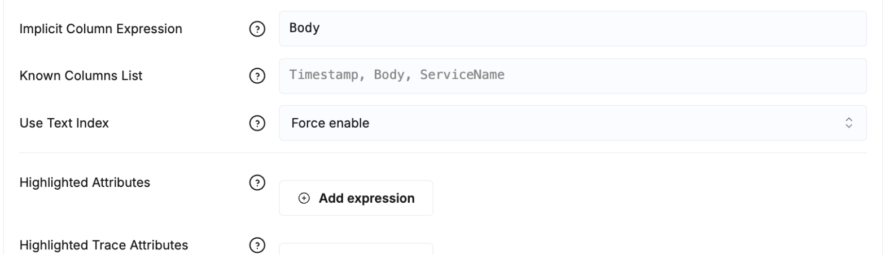
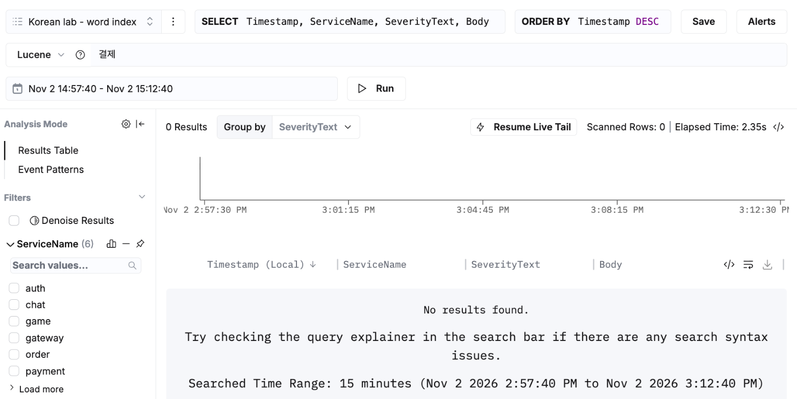
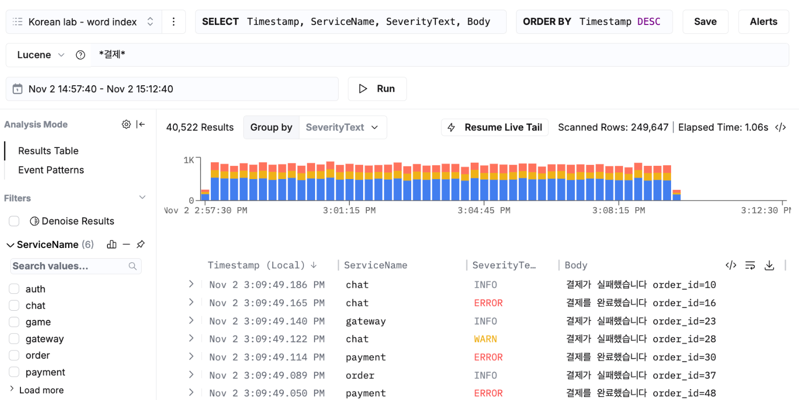
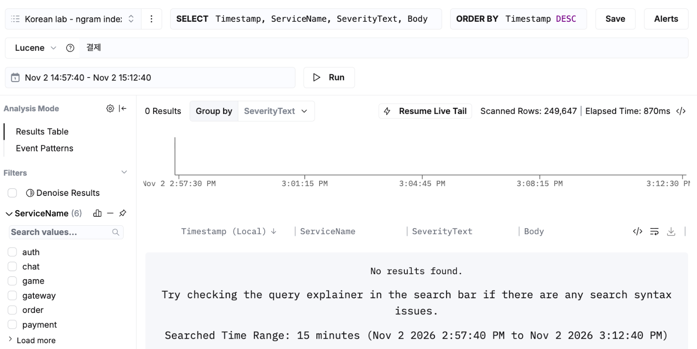
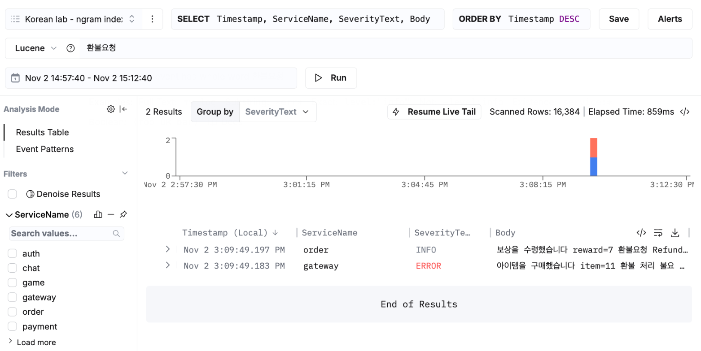

# labs/korean-log-search

[English](#english) | [한국어](#한국어)

## English

Search ClickStack logs for a Korean word and you can get **nothing back, with no error**. ClickHouse has no
Korean morphological analyser, and the body index of ClickStack's log table splits text into words, so
`결제` never matches `결제가` or `결제를` — the word with a particle attached. This lab shows that on
Managed ClickStack, the two settings that fix it, and what the fix costs, measured on the same data.

> **Verified on** ClickHouse Cloud 26.8.1.605 (2 replicas, ap-northeast-2) and Managed ClickStack
> HyperDX 2.41.0-sha38acb5a, 2026-11-02: `bin/run.sh` end to end (checks K1–K9 PASS), then the searches
> below in the ClickStack UI. Synthetic data, one run.

### What it shows

| | Body index | ClickStack source setting *Use Text Index* | Search `결제` |
|---|---|---|---|
| ClickStack default | `lower(Body)`, `text(tokenizer = 'splitByNonAlpha')` | Auto | **0 results** — the index has `결제가`, not `결제` |
| Index changed only | `lower(Body)`, `text(tokenizer = ngrams(2))` | Auto | **0 results** — Auto falls back to `hasToken`, which uses no index |
| Both changed | `lower(Body)`, `text(tokenizer = ngrams(2))` | **Force enable** | **every row** with `결제` in it, through the index |

A wildcard search (`*결제*`) returns the right rows on either index, as a `LIKE` that the default word index
cannot narrow.

### The two settings

1. **Table: replace the body index with `ngrams(2)`.** One expression can hold only one text index, so
   the word index is dropped, not kept beside it.

   ```sql
   ALTER TABLE otel_logs DROP INDEX idx_lower_body;
   ALTER TABLE otel_logs ADD INDEX idx_lower_body_ngram lower(Body) TYPE text(tokenizer = ngrams(2));
   ALTER TABLE otel_logs MATERIALIZE INDEX idx_lower_body_ngram;   -- existing parts; rewrites them
   ```

2. **ClickStack source: Use Text Index → Force enable.** *Team Settings → Data →* the log source →
   *Configure Optional Fields → Use Text Index*. In Auto, HyperDX uses a text index for a plain word only
   when its tokenizer is `splitByNonAlpha`; for any other tokenizer it renders `hasToken`, which no text
   index serves.

   

How HyperDX chooses (read in `packages/common-utils/src/queryParser.ts`, hyperdxio/hyperdx `main`,
2026-11-01, and confirmed in `system.query_log` from the UI): it takes the **first** text index in
`system.data_skipping_indices` whose expression names the searched column, and builds
`hasAllTokens(lower(Body), lower('<term>'))` when that index is on `lower(Body)`. A wildcard becomes
`lower(Body) LIKE lower('%<term>%')`.

### In the UI

The default word index, `결제`: no results.



The same index, `*결제*`: the rows are there (40,522 in this 15-minute range).



The ngram index with Use Text Index still on Auto: still no results.



The ngram index with Force enable: the same 40,522 rows.


The cost of 2-grams, in one screen: `환불요청` returns the row that has it, and a row that only has its
pieces apart (`환불 처리 불요 재요청`).



### Results

**Checks** (`sql/03_checks.sql`, every search in `WHERE`; ground truth from plain string functions on the
unindexed table):

| # | Shows | Expected | Actual |
|---|---|---|---|
| K1 | word index: `결제` finds nothing | 0 | 0 |
| K1+ | control: the rows exist | yes | yes (599,838) |
| K2 | ngram + `hasAllTokens` (Force enable): `결제` finds every row | 599,838 | 599,838 |
| K3 | ngram + `hasToken` (Auto): `결제` finds nothing | 0 | 0 |
| K4 | word index: a standalone word `환불요청` is exact | 3 | 3 |
| K5 | ngram: `환불요청` also matches the 3 decoy rows | 6 | 6 |
| K6 | wildcard `*환불요청*` is exact on both tables | 3 / 3 | 3 / 3 |
| K7 | word index: `error` matches the word only | 300,844 | 300,844 |
| K8 | ngram: `error` matches as a substring (`errors` too) | 599,863 | 599,863 |
| K9 | ngram: a one-character term `환` finds nothing | 0 | 0 |
| K9+ | control: `*환*` (LIKE) finds the rows | 6 | 6 |

**Granules read** for the UI-shaped searches over the last 15 minutes (`sql/04_results.sql`, from
`system.query_log`; the range alone covers 37–38 granules):

| Search | Index | Granules | Rows |
|---|---|---|---|
| `결제`, Auto | word | 0 | 0 |
| `결제`, Auto | ngram | 38 | 0 |
| `결제`, Force enable | ngram | 38 | rows (common term: the index cannot narrow it) |
| `환불요청`, Auto | word | 1 | 1 |
| `환불요청`, Auto | ngram | 38 | 1 |
| `환불요청`, Force enable | ngram | 2 | 2 (one false) |
| `*환불요청*` | word | 37 | 1 |
| `*환불요청*` | ngram | 2 | 1 |

**Size and insert cost** (3,000,000 rows, one part per partition after `OPTIMIZE FINAL`):

| | word index | ngram index |
|---|---|---|
| Body index, compressed | 42.47 MiB | 70.71 MiB (1.67×) |
| CPU to copy the rows in (no index: 1.59 s) | 3.08 s | 5.72 s |
| Index build CPU above the plain copy | 1.49 s | 4.13 s (2.8×) |

The data itself compresses to 11.6 MiB because the messages come from ten templates, so the index-to-data
ratio here (3.6× and 6.1×) says nothing about real logs. Compare the two indexes with each other.

### Trade-offs of the change

- **Korean words are found**, particles attached or not, and rare ones through the index.
- **English becomes substring search.** `error` also matches `errors`; very short terms (`id`, `ok`) match
  almost every row and the index cannot narrow them.
- **False matches**: a term of three or more characters matches any row that holds all its 2-grams, even
  apart (K5). Phrases with a space are safe — HyperDX adds a `LIKE` on the whole phrase.
- **One-character terms** find nothing through the index (K9); use the wildcard.
- **Bigger index, more insert CPU** (table above); `MATERIALIZE INDEX` rewrites existing parts.
- **`hasAllTokens` outside `WHERE` is not stable.** On the ngram table,
  `SELECT countIf(hasAllTokens(lower(Body), lower('결제')))` returned 599,838 with no `WHERE` and **0** once
  `WHERE Timestamp > now() - INTERVAL 1 HOUR` was added (same session, same build). The search page puts the
  term in `WHERE`; charts, alerts and dashboards were not checked.

### Running it

Needs `clickhouse client` and a ClickHouse Cloud service with Managed ClickStack. Credentials come from the
environment (`.env.example`); nothing outside the database `korean_log_search` is touched.

```bash
cp .env.example .env    # fill in CH_HOST, CH_USER, CH_PASSWORD
set -a; . ./.env; set +a
bin/run.sh              # install, checks, the UI-shaped searches, results
```

Then, for the UI: in ClickStack add two log sources, `korean_log_search.logs_word` and
`korean_log_search.logs_ngram` (Timestamp column `Timestamp`, apply the detected Service, Level and Body
fields), search `결제`, `*결제*` and `환불요청` in the last 15 minutes, switch the ngram source to Force
enable and search again. The rows end at load time; re-run `bin/run.sh install` to move them to now.
Remove everything with `bin/run.sh drop` and delete the two sources.

### Honest limits

- Synthetic data from ten templates; index sizes and CPU on real logs will differ — measure on a sample.
- One run on one service; CPU comes from one `INSERT … SELECT` per table.
- Charts, alerts and dashboards with these indexes were not checked.

### Layout

```
labs/korean-log-search/
├── README.md
├── .env.example
├── bin/run.sh            install · check · searches · results · drop
├── sql/
│   ├── 01_schema.sql     four tables shaped like otel_logs (no index, copy, word, ngram)
│   ├── 02_load.sql       3,000,000 rows, ten templates, two rare markers
│   ├── 03_checks.sql     K1–K9 with ground truth
│   ├── 04_results.sql    index size, copy CPU, granules per search
│   └── 99_drop.sql
└── images/               ClickStack UI, 2026-11-02
```

## 한국어

ClickStack에서 한국어 단어로 로그를 검색하면 **오류 없이 결과가 0건**일 수 있습니다. ClickHouse에는 한국어
형태소 분석기가 없고, ClickStack 로그 테이블의 Body 색인은 글을 단어 단위로 나눕니다. 그래서 `결제`는 조사가
붙은 `결제가`, `결제를`과 맞지 않습니다. 이 실습은 그 현상을 Managed ClickStack에서 보이고, 고치는 설정 두 가지와
그 대가를 같은 데이터로 잽니다.

> **검증** ClickHouse Cloud 26.8.1.605(replica 2, ap-northeast-2), Managed ClickStack HyperDX
> 2.41.0-sha38acb5a, 2026-11-02: `bin/run.sh` 처음부터 끝까지(검사 K1–K9 PASS), 이어서 아래 검색을 ClickStack
> 화면에서 실행. 합성 데이터, 한 번 실행.

### 보여주는 것

| | Body 색인 | ClickStack 소스 설정 *Use Text Index* | `결제` 검색 |
|---|---|---|---|
| ClickStack 기본 | `lower(Body)`, `text(tokenizer = 'splitByNonAlpha')` | Auto | **0건** — 색인에는 `결제`가 아니라 `결제가`가 있음 |
| 색인만 바꿈 | `lower(Body)`, `text(tokenizer = ngrams(2))` | Auto | **0건** — Auto는 색인을 쓰지 않는 `hasToken`으로 내려감 |
| 둘 다 바꿈 | `lower(Body)`, `text(tokenizer = ngrams(2))` | **Force enable** | `결제`가 들어간 **모든 행**, 색인으로 |

와일드카드(`*결제*`)는 두 색인 모두 맞는 행을 돌려줍니다. `LIKE`로 바뀌는데, 기본 단어 색인은 이 조건으로 읽을
범위를 줄이지 못합니다.

### 설정 두 가지

1. **테이블: Body 색인을 `ngrams(2)`로 교체.** 한 식에는 text index를 하나만 걸 수 있어서, 단어 색인을 옆에
   두지 못하고 지웁니다.

   ```sql
   ALTER TABLE otel_logs DROP INDEX idx_lower_body;
   ALTER TABLE otel_logs ADD INDEX idx_lower_body_ngram lower(Body) TYPE text(tokenizer = ngrams(2));
   ALTER TABLE otel_logs MATERIALIZE INDEX idx_lower_body_ngram;   -- 기존 part. 다시 씁니다
   ```

2. **ClickStack 소스: Use Text Index → Force enable.** *Team Settings → Data →* 로그 소스 →
   *Configure Optional Fields → Use Text Index*. Auto에서 HyperDX는 토크나이저가 `splitByNonAlpha`인 색인만
   단어 검색에 쓰고, 다른 토크나이저면 어떤 text index도 쓰지 않는 `hasToken`을 만듭니다.

   

HyperDX가 고르는 방식(hyperdxio/hyperdx `main` 2026-11-01의 `packages/common-utils/src/queryParser.ts`를 읽고,
화면에서 보낸 SQL을 `system.query_log`로 확인): `system.data_skipping_indices`에서 검색 열 이름이 식에 들어간
**첫** text index를 고르고, 그 색인이 `lower(Body)`에 있으면 `hasAllTokens(lower(Body), lower('<검색어>'))`를
만듭니다. 와일드카드는 `lower(Body) LIKE lower('%<검색어>%')`가 됩니다.

### 화면에서

기본 단어 색인, `결제`: 결과 없음.


같은 색인, `*결제*`: 행이 있습니다(이 15분 범위에서 40,522건).


ngram 색인인데 Use Text Index가 Auto: 여전히 결과 없음.


ngram 색인 + Force enable: 같은 40,522건.


2-gram의 대가를 한 화면에: `환불요청`이 그 단어가 있는 행과, 조각만 떨어져 있는 행(`환불 처리 불요 재요청`)을
함께 돌려줍니다.


### 결과

**검사**(`sql/03_checks.sql`, 모든 검색은 `WHERE`. 정답은 색인 없는 표에서 문자열 함수로 셈):

| # | 보여주는 것 | 기대 | 실제 |
|---|---|---|---|
| K1 | 단어 색인: `결제`가 아무것도 못 찾음 | 0 | 0 |
| K1+ | 대조: 행은 있음 | 있음 | 있음(599,838) |
| K2 | ngram + `hasAllTokens`(Force enable): `결제`가 모든 행을 찾음 | 599,838 | 599,838 |
| K3 | ngram + `hasToken`(Auto): `결제`가 아무것도 못 찾음 | 0 | 0 |
| K4 | 단어 색인: 단독 단어 `환불요청`은 정확 | 3 | 3 |
| K5 | ngram: `환불요청`이 미끼 3행까지 맞춤 | 6 | 6 |
| K6 | 와일드카드 `*환불요청*`은 두 표 모두 정확 | 3 / 3 | 3 / 3 |
| K7 | 단어 색인: `error`는 단어만 맞춤 | 300,844 | 300,844 |
| K8 | ngram: `error`가 부분 문자열로 맞춤(`errors`도) | 599,863 | 599,863 |
| K9 | ngram: 한 글자 `환`은 아무것도 못 찾음 | 0 | 0 |
| K9+ | 대조: `*환*`(LIKE)은 행을 찾음 | 6 | 6 |

**읽은 granule**, 최근 15분 화면 형태 검색(`sql/04_results.sql`, `system.query_log`. 시간 범위만으로 37~38개):

| 검색 | 색인 | Granule | 행 |
|---|---|---|---|
| `결제`, Auto | 단어 | 0 | 0 |
| `결제`, Auto | ngram | 38 | 0 |
| `결제`, Force enable | ngram | 38 | 있음(흔한 단어라 색인이 범위를 줄이지 못함) |
| `환불요청`, Auto | 단어 | 1 | 1 |
| `환불요청`, Auto | ngram | 38 | 1 |
| `환불요청`, Force enable | ngram | 2 | 2(하나는 오탐) |
| `*환불요청*` | 단어 | 37 | 1 |
| `*환불요청*` | ngram | 2 | 1 |

**크기와 입수 비용**(3,000,000행, `OPTIMIZE FINAL` 뒤 partition마다 part 하나):

| | 단어 색인 | ngram 색인 |
|---|---|---|
| Body 색인(압축) | 42.47 MiB | 70.71 MiB(1.67배) |
| 행을 복사해 넣는 CPU(색인 없음: 1.59 s) | 3.08 s | 5.72 s |
| 색인 없는 복사보다 더 든 CPU | 1.49 s | 4.13 s(2.8배) |

데이터 자체는 메시지가 템플릿 10개라 11.6 MiB로 압축됩니다. 그래서 여기서 색인 대 데이터 비율(3.6배, 6.1배)은
실제 로그와 상관이 없습니다. 두 색인끼리 비교해 주세요.

### 바꿨을 때의 trade-off

- **한국어 단어를 찾습니다.** 조사가 붙어도, 드문 단어는 색인으로.
- **영어가 부분 문자열 검색이 됩니다.** `error`가 `errors`에도 맞고, `id`, `ok`처럼 아주 짧은 단어는 거의 모든
  행에 맞아 색인이 범위를 줄이지 못합니다.
- **오탐**: 세 글자 이상 검색어는 그 2-gram이 모두 있는 행이면 떨어져 있어도 맞습니다(K5). 띄어쓰기가 있는 문구는
  괜찮습니다 — HyperDX가 문구 전체에 `LIKE`를 붙입니다.
- **한 글자 검색어**는 색인으로 아무것도 못 찾습니다(K9). 와일드카드를 쓰세요.
- **색인이 더 크고 입수 CPU가 더 듭니다**(위 표). `MATERIALIZE INDEX`는 기존 part를 다시 씁니다.
- **`WHERE` 밖의 `hasAllTokens`는 일정하지 않습니다.** ngram 표에서
  `SELECT countIf(hasAllTokens(lower(Body), lower('결제')))`가 `WHERE` 없이는 599,838, 
  `WHERE Timestamp > now() - INTERVAL 1 HOUR`를 더하면 **0**이었습니다(같은 세션, 같은 빌드). 검색 화면은 검색어를
  `WHERE`에 넣습니다. 차트, 알람, 대시보드는 확인하지 않았습니다.

### 실행

`clickhouse client`와 Managed ClickStack이 있는 ClickHouse Cloud 서비스가 필요합니다. 자격 증명은 환경 변수로
받고(`.env.example`), `korean_log_search` 데이터베이스 밖은 건드리지 않습니다.

```bash
cp .env.example .env    # CH_HOST, CH_USER, CH_PASSWORD 채우기
set -a; . ./.env; set +a
bin/run.sh              # 설치, 검사, 화면 형태 검색, 결과
```

화면은: ClickStack에 로그 소스 두 개 `korean_log_search.logs_word`, `korean_log_search.logs_ngram`을 추가하고
(Timestamp 열 `Timestamp`, 감지된 Service·Level·Body 필드 적용), 최근 15분에서 `결제`, `*결제*`, `환불요청`을
검색한 뒤, ngram 소스를 Force enable로 바꿔 다시 검색합니다. 행은 적재 시각에 끝나므로, `bin/run.sh install`을
다시 돌리면 지금 시각으로 옮겨집니다. 정리는 `bin/run.sh drop`과 소스 두 개 삭제입니다.

### 정직하게 밝히는 한계

- 템플릿 10개로 만든 합성 데이터입니다. 실제 로그의 색인 크기와 CPU는 다릅니다 — 표본으로 재 보세요.
- 서비스 하나에서 한 번 실행했고, CPU는 표마다 `INSERT … SELECT` 한 번의 값입니다.
- 이 색인으로 차트, 알람, 대시보드는 확인하지 않았습니다.

### 구성

```
labs/korean-log-search/
├── README.md
├── .env.example
├── bin/run.sh            install · check · searches · results · drop
├── sql/
│   ├── 01_schema.sql     otel_logs 형태 표 넷(색인 없음, 복사, 단어, ngram)
│   ├── 02_load.sql       3,000,000행, 템플릿 10개, 드문 표식 둘
│   ├── 03_checks.sql     K1–K9, 정답과 비교
│   ├── 04_results.sql    색인 크기, 복사 CPU, 검색별 granule
│   └── 99_drop.sql
└── images/               ClickStack 화면, 2026-11-02
```
