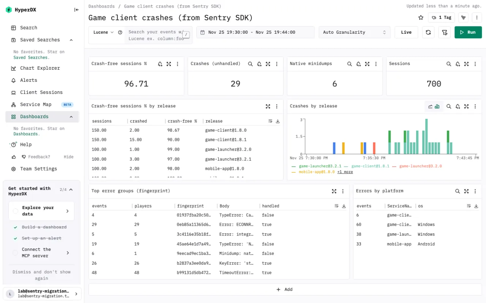
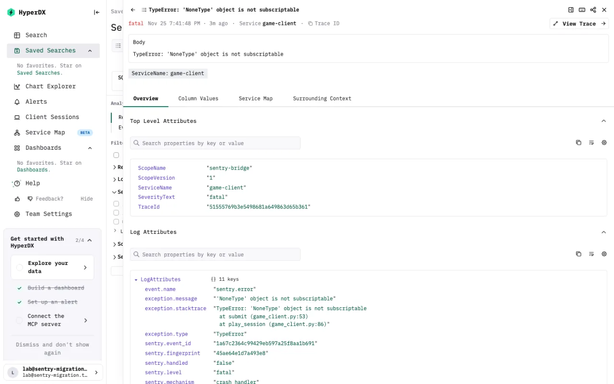

# Sentry SDK crash and error reports into ClickStack

[English](#english) | [한국어](#한국어)

## English

Verified on clickstack-all-in-one 2.39.1 (ClickHouse 26.8.7.19), Sentry Python SDK 3.0.0 and Sentry Node SDK 11.17.0, local Docker on macOS, 2026-11-25.

**The question.** A game launcher, a game client and a mobile app report crashes and errors with the Sentry SDK. Can that data go to ClickStack without touching the client code, only the DSN, and can the old and new systems run side by side while you compare them? What carries over and what does not?

### Layout

```
 game launcher ─┐  Sentry SDK, DSN host = bridge
 game client  ──┼─▶  bridge  /api/<project>/envelope/   (errors, sessions, attachments)
 mobile app   ──┘           /api/<project>/minidump/   (Crashpad / Breakpad form upload)
                       │  │
                       │  └─▶ tee: the same request, unchanged ─▶ existing Sentry (here: upstream mock)
                       ▼
                OTLP/HTTP logs ─▶ ClickStack collector ─▶ otel_logs ─▶ search · dashboard · alert
```

- [`bridge/bridge.py`](bridge/bridge.py): standard library only. Checks the DSN key per project, reads gzip, deflate and chunked bodies, parses the envelope and writes one OTel log record per item. With `UPSTREAM_URL` set, it forwards every request unchanged as well.
- [`bridge/upstream_mock.py`](bridge/upstream_mock.py): stands in for the existing Sentry. It counts what the tee delivered, and receives the alert webhook.
- [`clients/`](clients/): the real SDKs. `launcher.mjs` uses `@sentry/node`, which `@sentry/electron`'s main process builds on. `game_client.py` uses `sentry-sdk` for a Windows client and an Android app. They exercise the envelope protocol that the Unity, Unreal and native SDKs also speak. They do not run a game engine.
- [`bin/send-minidump.sh`](bin/send-minidump.sh): uploads a native crash the way Crashpad does. The dump is **synthetic** (an `MDMP` header plus random bytes).
- [`bin/run-scenario.sh`](bin/run-scenario.sh): runs 10 minutes of traffic in two releases. In 1.8.1 the game client has a render crash in 8% of sessions.
- [`bin/hyperdx-setup.py`](bin/hyperdx-setup.py): creates a webhook, three saved searches, the dashboard and the alert through the HyperDX v2 API.
- [`sql/verify.sql`](sql/verify.sql) and [`bin/verify.sh`](bin/verify.sh): check what arrived, by SQL.

### Mapping

| Sentry item | OTel log record |
|---|---|
| `event` | body `"<type>: <value>"`, severity from `level`, `exception.type` / `exception.message` / `exception.stacktrace`, `sentry.event_id`, `sentry.handled`, `sentry.mechanism`, `sentry.fingerprint`, `sentry.tag.*`, `user.id`. Resource: `service.name`, `service.version` = release, `deployment.environment`, `os.*`, `device.model.identifier`. Trace id when the event carries one |
| `session` | `event.name = sentry.session`, status (`ok` / `exited` / `crashed` / `abnormal`), session id, error count |
| `sessions` (aggregates) | one record per bucket with exited / errored / crashed / abnormal counts |
| `attachment` (minidump) | a receipt: name, size, sha256, path on the bridge volume |
| minidump form upload | a `fatal` event (`Minidump: native crash (not symbolicated)`) plus the receipt |
| `transaction`, `profile`, `replay_*`, `client_report` | counted, not forwarded |

`sentry.fingerprint` is the bridge's own grouping key, close to Sentry's default but not the same: the exception type plus the module and function of the last five in-app frames, with line numbers ignored. An explicit `fingerprint` on the event wins. User email and IP are not copied.

### Run

```bash
cp .env.example .env
docker compose up -d                              # ClickStack on 18080, bridge on 9800
# sign up at http://localhost:18080, copy the Ingestion API key into .env, then
docker compose up -d bridge
HDX_KEY=<personal API access key> python3 bin/hyperdx-setup.py
bin/run-scenario.sh                               # 10 minutes
bin/verify.sh
docker compose down -v
```

A client changes only its DSN: `http://<public_key>@<bridge host>:9800/<project_id>`.

### Result (2026-11-25)

Full record with every capture: [results/2026-11-25-local.md](results/2026-11-25-local.md).

- **Counts end to end.** The bridge parsed 131 events, 736 session updates and 6 minidumps. ClickHouse holds 137 `sentry.error` (131 + 6 minidump events), 736 `sentry.session` and 6 `sentry.attachment`, which equals the bridge's 879 OTLP records. In the tee check, the old system got the same 43 requests, 56 session items, 14 events and 2 minidumps.
- **Release health.** Crash-free sessions per release, counted over distinct session ids, were 98.67% for game client 1.8.0 and 90.00% for 1.8.1. Every crashed count equals what the clients printed.
- **The Node SDK sends `crashed` twice for one session.** Count session ids, not rows. Counting rows gave 94% crash-free for launcher 3.2.1 instead of 97%.
- **Grouping.** The render crash is a single group across Windows, Android and both releases.
- **Alert.** "Crash spike" (more than 5 unhandled crashes per 5 minutes) went to ALERT for the 1.8.1 window, and its webhook arrived once.





More captures: [search for crashes](images/04-search-crashes.webp), [minidump receipts](images/06-search-minidumps.webp), [error groups](images/03-dashboard-groups.webp), [the alert](images/07-alerts.webp).

### What does not carry over

- **Issue workflow.** Sentry's issues (assign, resolve, regression, merge, ownership rules, release-based "resolved in next release") have no ClickStack equivalent. ClickStack gives search, dashboards and alerts over the events.
- **Symbolication.** Native minidumps are stored but not processed. The same goes for IL2CPP or Mono stacks without symbols, ProGuard/R8 maps and JavaScript source maps. Frames stay as the SDK sent them. A production setup needs a step such as `minidump-stackwalk` with your symbol files, which this lab does not run.
- **Grouping is approximate.** The fingerprint follows the same idea as Sentry's default, but it is not Sentry's algorithm. Group counts can differ.
- **Transactions, profiles and session replays** are counted and dropped. Use OpenTelemetry traces and the ClickStack browser SDK for those.
- **Back-pressure.** The bridge always answers 200. It sends no rate-limit headers (`429`, `X-Sentry-Rate-Limits`) back to clients.
- **Attachments** stay on the bridge's volume. Put them in object storage before production.

## 한국어

clickstack-all-in-one 2.39.1(ClickHouse 26.8.7.19), Sentry Python SDK 3.0.0, Sentry Node SDK 11.17.0, macOS 로컬 Docker에서 검증, 2026-11-25.

**질문.** 게임 런처, 게임 클라이언트, 모바일 앱이 Sentry SDK로 크래시와 오류를 보고합니다. 클라이언트 코드는 건드리지 않고 DSN만 바꿔서 이 데이터를 ClickStack으로 보낼 수 있을까요? 기존 시스템과 새 시스템을 나란히 돌리며 비교할 수 있을까요? 무엇이 넘어오고 무엇이 넘어오지 않을까요?

### 구성

```
 게임 런처     ─┐  Sentry SDK, DSN 호스트 = bridge
 게임 클라이언트 ─┼─▶  bridge  /api/<project>/envelope/   (오류, 세션, 첨부)
 모바일 앱     ─┘           /api/<project>/minidump/   (Crashpad / Breakpad 업로드)
                       │  │
                       │  └─▶ tee: 같은 요청을 그대로 ─▶ 기존 Sentry (여기서는 upstream mock)
                       ▼
                OTLP/HTTP logs ─▶ ClickStack collector ─▶ otel_logs ─▶ 검색 · 대시보드 · 알림
```

- [`bridge/bridge.py`](bridge/bridge.py): 표준 라이브러리만 씁니다. 프로젝트별로 DSN 키를 확인하고, gzip·deflate·chunked 본문을 읽고, envelope을 풀어 항목 하나를 OTel 로그 레코드 하나로 씁니다. `UPSTREAM_URL`을 주면 모든 요청을 그대로 함께 보냅니다.
- [`bridge/upstream_mock.py`](bridge/upstream_mock.py): 기존 Sentry를 대신합니다. tee로 받은 것을 세고, 알림 webhook도 받습니다.
- [`clients/`](clients/): 실제 SDK를 씁니다. `launcher.mjs`는 `@sentry/node`(`@sentry/electron`의 main process가 이 위에 있습니다), `game_client.py`는 `sentry-sdk`로 Windows 클라이언트와 Android 앱을 흉내 냅니다. Unity·Unreal·네이티브 SDK도 쓰는 envelope 프로토콜을 검증하는 것이고, 게임 엔진을 돌리지는 않습니다.
- [`bin/send-minidump.sh`](bin/send-minidump.sh): Crashpad처럼 네이티브 크래시를 올립니다. 덤프는 **합성**입니다(`MDMP` 헤더 + 임의 바이트).
- [`bin/run-scenario.sh`](bin/run-scenario.sh): 두 릴리스에 걸쳐 10분간 트래픽을 보냅니다. 1.8.1에서는 게임 클라이언트 세션의 8%에서 렌더 크래시가 납니다.
- [`bin/hyperdx-setup.py`](bin/hyperdx-setup.py): HyperDX v2 API로 webhook, 저장 검색 셋, 대시보드, 알림을 만듭니다.
- [`sql/verify.sql`](sql/verify.sql)·[`bin/verify.sh`](bin/verify.sh): 도착한 것을 SQL로 확인합니다.

### 매핑

| Sentry 항목 | OTel 로그 레코드 |
|---|---|
| `event` | body `"<type>: <value>"`, `level`에서 severity, `exception.type`·`exception.message`·`exception.stacktrace`, `sentry.event_id`, `sentry.handled`, `sentry.mechanism`, `sentry.fingerprint`, `sentry.tag.*`, `user.id`. resource: `service.name`, `service.version`(= release), `deployment.environment`, `os.*`, `device.model.identifier`. 이벤트에 trace id가 있으면 함께 |
| `session` | `event.name = sentry.session`, 상태(`ok`·`exited`·`crashed`·`abnormal`), 세션 id, 오류 수 |
| `sessions`(집계) | 버킷마다 exited·errored·crashed·abnormal 수를 담은 레코드 하나 |
| `attachment`(미니덤프) | 영수증: 이름, 크기, sha256, bridge 볼륨의 경로 |
| 미니덤프 폼 업로드 | `fatal` 이벤트(`Minidump: native crash (not symbolicated)`) + 영수증 |
| `transaction`·`profile`·`replay_*`·`client_report` | 세기만 하고 보내지 않음 |

`sentry.fingerprint`는 bridge가 만드는 그룹 키입니다. Sentry 기본 그룹핑과 비슷하지만 같지는 않습니다. 예외 타입에 마지막 in-app 프레임 다섯 개의 모듈·함수를 더하고, 줄 번호는 무시합니다. 이벤트에 `fingerprint`가 따로 있으면 그것을 씁니다. 사용자 이메일과 IP는 옮기지 않습니다.

### 실행

```bash
cp .env.example .env
docker compose up -d                              # ClickStack 18080, bridge 9800
# http://localhost:18080 에서 가입하고 Ingestion API key를 .env에 넣은 뒤
docker compose up -d bridge
HDX_KEY=<personal API access key> python3 bin/hyperdx-setup.py
bin/run-scenario.sh                               # 10분
bin/verify.sh
docker compose down -v
```

클라이언트는 DSN만 바꿉니다: `http://<public_key>@<bridge 호스트>:9800/<project_id>`.

### 결과 (2026-11-25)

캡처를 모두 담은 기록: [results/2026-11-25-local.md](results/2026-11-25-local.md).

- **건수가 처음부터 끝까지 맞습니다.** bridge가 이벤트 131건, 세션 업데이트 736건, 미니덤프 6건을 받았습니다. ClickHouse에는 `sentry.error` 137건(131 + 미니덤프 이벤트 6), `sentry.session` 736건, `sentry.attachment` 6건이 있고, 합하면 bridge의 OTLP 레코드 879건과 같습니다. tee 확인에서는 기존 시스템도 요청 43건, 세션 항목 56건, 이벤트 14건, 미니덤프 2건을 똑같이 받았습니다.
- **릴리스 상태.** 세션 id 기준 크래시 없는 세션 비율은 게임 클라이언트 1.8.0이 98.67%, 1.8.1이 90.00%였습니다. 크래시 수는 모두 클라이언트가 출력한 값과 같습니다.
- **Node SDK는 세션 하나에 `crashed`를 두 번 보냅니다.** 행이 아니라 세션 id를 세야 합니다. 행을 세면 런처 3.2.1이 97%가 아니라 94%로 나옵니다.
- **그룹핑.** 렌더 크래시는 Windows·Android, 두 릴리스에 걸쳐 그룹 하나로 묶입니다.
- **알림.** "Crash spike"(5분에 처리 안 된 크래시 5건 초과)가 1.8.1 구간에서 ALERT가 됐고, webhook이 한 번 도착했습니다.


다른 캡처: [크래시 검색](images/04-search-crashes.webp), [미니덤프 영수증](images/06-search-minidumps.webp), [오류 그룹](images/03-dashboard-groups.webp), [알림](images/07-alerts.webp).

### 넘어오지 않는 것

- **이슈 워크플로.** Sentry의 이슈 기능(담당 지정, 해결, 회귀, 병합, 소유 규칙, "다음 릴리스에서 해결")은 ClickStack에 대응하는 기능이 없습니다. ClickStack이 주는 것은 이벤트에 대한 검색·대시보드·알림입니다.
- **심볼리케이션.** 네이티브 미니덤프는 저장만 하고 처리하지 않습니다. 심볼 없는 IL2CPP·Mono 스택, ProGuard/R8 매핑, JavaScript 소스맵도 마찬가지로, 프레임은 SDK가 보낸 그대로 남습니다. 운영에는 심볼 파일과 함께 `minidump-stackwalk` 같은 단계가 필요하고, 이 실습은 그것을 돌리지 않았습니다.
- **그룹핑은 근사치입니다.** fingerprint는 Sentry 기본 그룹핑과 같은 생각으로 만들었지만 Sentry의 알고리즘은 아닙니다. 그룹 수가 다를 수 있습니다.
- **트랜잭션·프로파일·세션 리플레이**는 세기만 하고 버립니다. 이것들은 OpenTelemetry trace와 ClickStack 브라우저 SDK로 다룹니다.
- **역압.** bridge는 항상 200으로 답합니다. 클라이언트에게 rate limit 헤더(`429`, `X-Sentry-Rate-Limits`)를 돌려주지 않습니다.
- **첨부 파일**은 bridge 볼륨에 남습니다. 운영 전에는 오브젝트 스토리지로 옮겨야 합니다.
