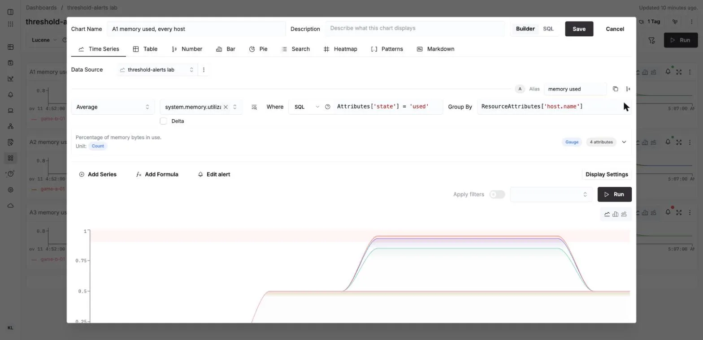
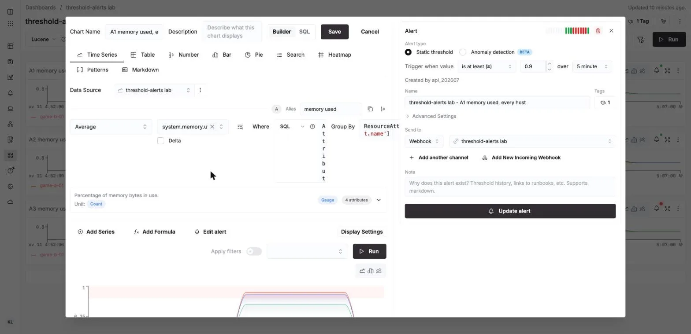
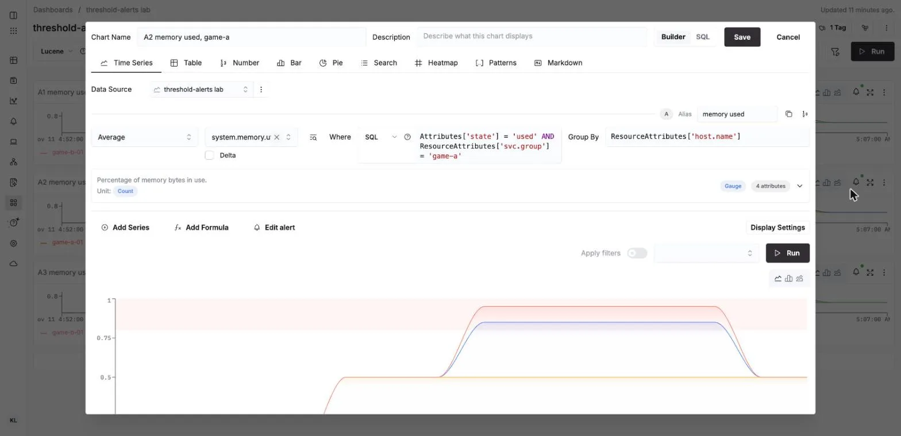
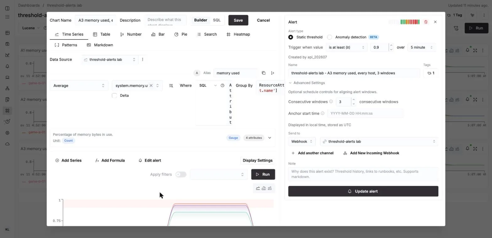
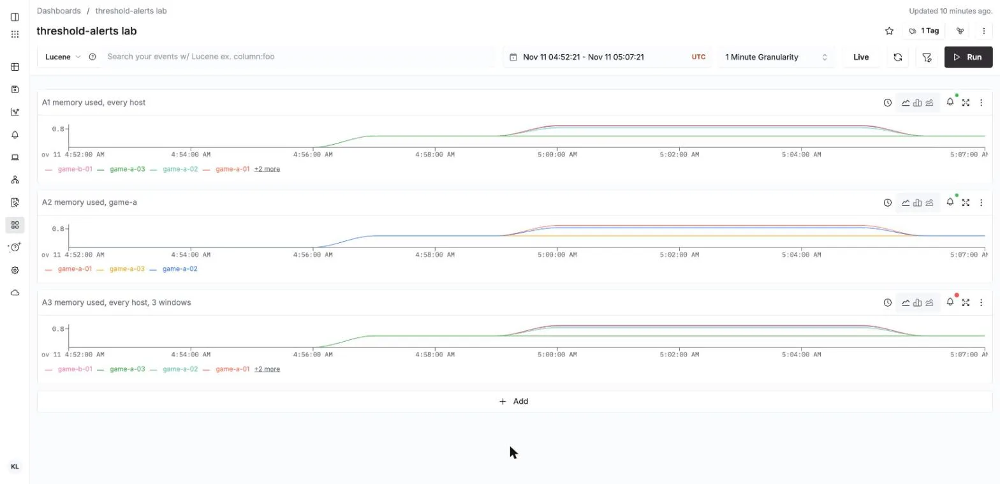
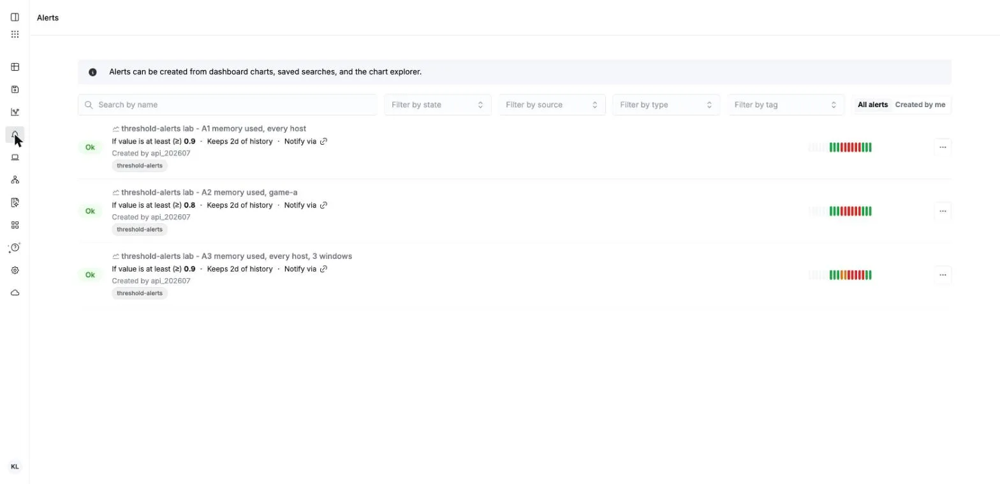
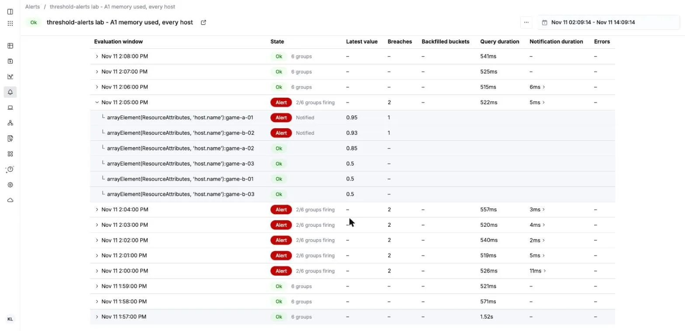
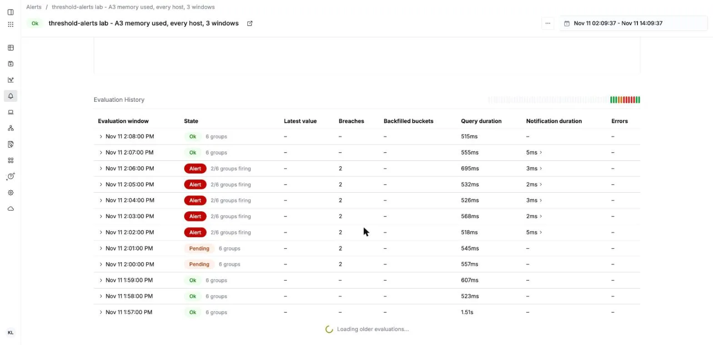

# Threshold alerts for host metrics in ClickStack: every host, or one server group

[English](#english) | [한국어](#한국어)

## English

Two alerts an infra team asks for first, built in the ClickStack chart builder:

1. **One threshold for every server** — for example memory used at least 90%, with a separate
   notification for each host that crosses it.
2. **A threshold for one server group only** — the hosts whose `svc.group` resource attribute
   (set from an EC2 tag, see [`labs/common-fields`](../common-fields/README.md)) is `game-a`.

> **Verified on** Managed ClickStack, our ClickHouse Cloud Seoul service (ClickHouse 26.8.1.654),
> 2026-11-11 04:57–05:08Z, one run. [`managed/threshold_alerts.py`](managed/threshold_alerts.py)
> created the metric source, dashboard, builder charts, alerts and a generic webhook through the
> ClickHouse Cloud API, sent synthetic `system.memory.utilization` for six hosts every 20 s, and
> counted the notifications at a local receiver behind a tunnel. Screens are from the same run.
> Report: [`results/2026-11-11-managed.md`](results/2026-11-11-managed.md).

### Result

Six hosts, two groups (`game-a-01..03`, `game-b-01..03`), all at 0.50; for six minutes
game-a-01 at 0.95, game-a-02 at 0.85, game-b-02 at 0.93; then all back at 0.50.

| Alert (builder line chart, Average, group by `host.name`, every 1 m) | Notified | Not notified | First window | Resolved |
|---|---|---|---|---|
| A1 every host, **≥ 0.9** | game-a-01, game-b-02 (6 each) | game-a-02 (0.85) and the rest | 05:00–05:01 | 05:06–05:07, per host |
| A2 `svc.group = 'game-a'` only, **≥ 0.8** | game-a-01, game-a-02 (6 each) | game-b-02 (0.93, other group) | 05:00–05:01 | 05:06–05:07, per host |
| A3 as A1 with **3 consecutive windows** | game-a-01, game-b-02 (5 each) | as A1 | 05:02–05:03 (2 windows Pending) | 05:07–05:08, per host |

What this means:

1. **One rule covers every host.** Group the chart by `host.name`; the alert then evaluates each
   host as its own group and notifies (and later resolves) each host on its own. The alert's
   history shows the groups of every window (screen 7).
2. **A server group is a filter on the same chart.** Add the group attribute to the chart's
   Where. A different threshold per group is one chart and alert per group.
3. **A breaching host is notified every window** (6 notifications in a 6-minute breach).
   Consecutive windows delays the first notification (here 2 windows Pending, then Alert) and
   still repeats after that; with many hosts, also look at the interval and how the receiving
   channel groups messages.

### Step by step

**1. A chart grouped by host.** Dashboards → Add → Time Series. Data Source: your metric source.
Average of `system.memory.utilization`, Where (SQL) `Attributes['state'] = 'used'`, Group By
`ResourceAttributes['host.name']`. The hostmetrics memory scraper sends one series per state
(used, free); the filter keeps one series per host.



**2. The alert on that chart.** Edit alert → Static threshold, "is at least (≥)" 0.9, Send to a
webhook (Slack or generic). The message template may use `{{group}}` and `{{value}}`.



The panel showed "over 5 minute" for these alerts, created with `interval: 1m` through the API;
the alert's own page says "Evaluates every 1m", and notifications came every minute. Pick the
interval you want when you create the alert in the UI.

**3. One server group.** The same chart with the group in Where:
`Attributes['state'] = 'used' AND ResourceAttributes['svc.group'] = 'game-a'`, alert at 0.8.



**4. Fewer notifications for short spikes.** Alert → Advanced Settings → Consecutive windows.



**5. Where to see it.** The dashboard (the bell turns red while an alert fires), the Alerts page,
and each alert's page with one row per window and, expanded, one row per host.









The alert pages show local time (KST here); the notifications and the report use UTC.

### What to know before rolling it out

- **A gauge is read as the last value in each window.** "Average" on a gauge metric takes each
  series' last value in the window, then averages across series (`last_value(Value)` in
  `packages/common-utils/src/core/renderChartConfig.ts`, HyperDX source read 2026-11-11). Grouped
  by host with one series per host, that is the host's latest sample. Seen here: the breach
  started at 05:00:51 and the 05:00–05:01 window already fired. With the hostmetrics default of
  one sample per minute, each window holds one sample anyway.
- **The notification title rounds the value** to one decimal: 0.93 arrived as
  "0.9 meets or exceeds 0.9". `{{value}}` in the message carried 0.93. "is at least" is ≥.
- **The group label is the expression**, as received:
  `Group: "arrayElement(ResourceAttributes, 'host.name'):game-b-02"`.
- **A host that stops sending does not fire a threshold alert** — there is no value to compare.
  That needs the expected-host-list alert in [`labs/process-down-alerts`](../process-down-alerts/README.md).
- **Consecutive windows, as measured once:** A3 fired from its third window and resolved one
  window after A1 (05:07–05:08 against 05:06–05:07), on the same chart query.

### Run it

```bash
ngrok http 9310                    # or any tunnel to 127.0.0.1:9310; optional
managed/threshold_alerts.py --webhook-url https://<tunnel> [--keep]   # ~14 min
managed/threshold_alerts.py --cleanup                                  # after --keep
managed/threshold_alerts.py --report <date>                            # report again from results/
```

Env files: `CH_HOST`, `CH_USER`, `CH_PASSWORD` (`--ch-env`) and `CHC_KEY`, `CHC_SECRET`
(`--api-env`). Everything it creates is named `threshold-alerts lab` and lives in the database
`threshold_alerts_lab`; `--cleanup` removes it. Without `--webhook-url` the webhook points at
example.com and only alert states are recorded (the Cloud API reports one state per alert, not
per host). Links and per-alert hashes are redacted before anything is written to `results/`.

| File | What |
|---|---|
| `managed/threshold_alerts.py` | source, dashboard, alerts, webhook; data sender; receiver; report |
| `results/2026-11-11-managed.md` | alert states every 30 s and every notification |
| `results/2026-11-11-webhook.jsonl`, `-managed-states.jsonl`, `-phases.json` | the raw records |
| `images/` | the screens above, from the same run |

Not covered: a Slack channel (the generic webhook carries the same text), CPU
(`system.cpu.utilization` has one series per CPU and state, so its filter and threshold differ —
not run here), one rule with a different threshold per group, silences, real hosts (the data is
synthetic in the hostmetrics shape), and the local OSS build.

---

## 한국어

인프라 팀이 가장 먼저 찾는 알림 두 가지를 ClickStack 차트 빌더로 만듭니다.

1. **전체 서버에 같은 임계치** — 예: 메모리 사용률 90% 이상. 넘은 호스트마다 알림이 따로 갑니다.
2. **특정 서버군만 임계치** — 리소스 속성 `svc.group`이 `game-a`인 호스트만. 이 속성은 EC2 태그에서
   넣습니다([`labs/common-fields`](../common-fields/README.md) 참고).

> **검증:** Managed ClickStack, 우리 ClickHouse Cloud 서울 서비스(ClickHouse 26.8.1.654),
> 2026-11-11 04:57–05:08Z, 1회. [`managed/threshold_alerts.py`](managed/threshold_alerts.py)가 ClickHouse
> Cloud API로 메트릭 소스, 대시보드, 빌더 차트, 알림, generic webhook을 만들고, 호스트 6대의 합성
> `system.memory.utilization`을 20초마다 보내고, 터널 뒤 로컬 수신기에서 알림을 셌습니다. 화면도 같은
> 실행에서 찍었습니다. 보고: [`results/2026-11-11-managed.md`](results/2026-11-11-managed.md).

### 결과

호스트 6대, 서버군 2개(`game-a-01..03`, `game-b-01..03`), 모두 0.50에서 시작합니다. 6분 동안
game-a-01은 0.95, game-a-02는 0.85, game-b-02는 0.93으로 올리고, 그 뒤 모두 0.50으로 되돌렸습니다.

| 알림 (빌더 line 차트, Average, `host.name`으로 group by, 1분마다) | 알림 받음 | 알림 없음 | 첫 구간 | 해소 |
|---|---|---|---|---|
| A1 전체 호스트, **0.9 이상** | game-a-01, game-b-02 (각 6건) | game-a-02(0.85)와 나머지 | 05:00–05:01 | 05:06–05:07, 호스트별 |
| A2 `svc.group = 'game-a'`만, **0.8 이상** | game-a-01, game-a-02 (각 6건) | game-b-02(0.93, 다른 서버군) | 05:00–05:01 | 05:06–05:07, 호스트별 |
| A3 A1과 같고 **연속 3구간** | game-a-01, game-b-02 (각 5건) | A1과 같음 | 05:02–05:03 (2구간 Pending) | 05:07–05:08, 호스트별 |

뜻:

1. **규칙 하나로 모든 호스트를 봅니다.** 차트를 `host.name`으로 group by 하면 알림이 호스트마다 따로
   평가하고, 호스트마다 따로 알리고 해소합니다. 알림 이력에서 구간마다 호스트별 상태를 볼 수 있습니다
   (화면 7).
2. **서버군은 같은 차트에 거는 필터입니다.** 차트의 Where에 서버군 속성을 더합니다. 서버군마다 임계치가
   다르면 서버군마다 차트와 알림을 하나씩 둡니다.
3. **넘은 호스트는 구간마다 다시 알립니다**(6분 초과에 6건). 연속 구간은 첫 알림을 늦출 뿐(여기서는
   2구간 Pending 뒤 Alert) 그 뒤에는 똑같이 반복합니다. 호스트가 많으면 평가 간격과 받는 채널의
   메시지 묶기도 함께 정하세요.

### 따라 하기

**1. 호스트별로 묶은 차트.** Dashboards → Add → Time Series. Data Source는 메트릭 소스.
`system.memory.utilization`의 Average, Where(SQL) `Attributes['state'] = 'used'`, Group By
`ResourceAttributes['host.name']`. hostmetrics memory scraper는 상태(used, free)마다 시계열을 보내므로,
이 필터로 호스트당 시계열 하나만 남깁니다.


**2. 그 차트에 알림.** Edit alert → Static threshold, "is at least (≥)" 0.9, Send to에 webhook(Slack
또는 generic). 메시지 템플릿에 `{{group}}`, `{{value}}`를 쓸 수 있습니다.


API로 `interval: 1m`을 넣어 만든 이 알림들은 패널에 "over 5 minute"로 보였습니다. 알림 페이지에는
"Evaluates every 1m"로 나오고, 알림도 1분마다 왔습니다. UI에서 만들 때는 원하는 간격을 직접 고르세요.

**3. 서버군 하나.** 같은 차트의 Where에 서버군을 더합니다:
`Attributes['state'] = 'used' AND ResourceAttributes['svc.group'] = 'game-a'`, 알림은 0.8.


**4. 짧은 튐에 알림 줄이기.** 알림 → Advanced Settings → Consecutive windows.


**5. 보는 곳.** 대시보드(알림이 울리는 동안 종 아이콘이 빨간색), Alerts 페이지, 알림마다의 페이지(구간마다
한 줄, 펼치면 호스트마다 한 줄).


알림 페이지는 현지 시각(여기서는 KST), 알림 본문과 보고서는 UTC입니다.

### 적용 전에 알아 둘 것

- **gauge는 구간의 마지막 값으로 읽습니다.** gauge 메트릭의 "Average"는 시계열마다 구간 안의 마지막
  값을 잡은 뒤 시계열끼리 평균합니다(HyperDX 소스 `packages/common-utils/src/core/renderChartConfig.ts`의
  `last_value(Value)`, 2026-11-11에 읽음). 호스트로 group by 하고 호스트당 시계열이 하나면 그 호스트의
  마지막 샘플입니다. 이번 실행에서도 05:00:51에 올렸는데 05:00–05:01 구간이 이미 울렸습니다.
  hostmetrics 기본값(1분에 샘플 하나)이면 어차피 구간마다 샘플이 하나입니다.
- **알림 제목의 값은 소수 한 자리로 반올림됩니다.** 0.93이 "0.9 meets or exceeds 0.9"로 왔습니다.
  메시지의 `{{value}}`에는 0.93이 그대로 들어갔습니다. "is at least"는 ≥입니다.
- **그룹 이름은 식 그대로 옵니다:** `Group: "arrayElement(ResourceAttributes, 'host.name'):game-b-02"`.
- **데이터를 보내지 않게 된 호스트는 임계치 알림이 울리지 않습니다** — 비교할 값이 없습니다. 이 경우는
  [`labs/process-down-alerts`](../process-down-alerts/README.md)의 기대 호스트 목록 알림을 씁니다.
- **연속 구간(1회 측정):** A3는 세 번째 구간부터 울렸고, 같은 차트 쿼리인 A1보다 한 구간 늦게
  해소됐습니다(05:07–05:08 대 05:06–05:07).

### 실행

```bash
ngrok http 9310                    # 127.0.0.1:9310으로 가는 터널이면 무엇이든; 선택
managed/threshold_alerts.py --webhook-url https://<tunnel> [--keep]   # 약 14분
managed/threshold_alerts.py --cleanup                                  # --keep 뒤에
managed/threshold_alerts.py --report <date>                            # results/에서 보고서 다시 만들기
```

환경 파일: `CH_HOST`, `CH_USER`, `CH_PASSWORD`(`--ch-env`)와 `CHC_KEY`, `CHC_SECRET`(`--api-env`).
만드는 것은 모두 이름이 `threshold-alerts lab`이고 데이터베이스는 `threshold_alerts_lab`이며,
`--cleanup`이 지웁니다. `--webhook-url`이 없으면 webhook이 example.com을 가리키고 알림 상태만
기록합니다(Cloud API는 알림마다 상태 하나만 주고 호스트별로는 주지 않습니다). 링크와 알림별 해시는
`results/`에 쓰기 전에 가립니다.

| 파일 | 내용 |
|---|---|
| `managed/threshold_alerts.py` | 소스, 대시보드, 알림, webhook; 데이터 전송; 수신기; 보고서 |
| `results/2026-11-11-managed.md` | 30초마다의 알림 상태와 모든 알림 |
| `results/2026-11-11-webhook.jsonl`, `-managed-states.jsonl`, `-phases.json` | 원본 기록 |
| `images/` | 위 화면, 같은 실행 |

다루지 않은 것: Slack 채널(generic webhook에 같은 본문이 옴), CPU(`system.cpu.utilization`은 CPU와
상태마다 시계열이 있어 필터와 임계치가 다름 — 여기서는 실행하지 않음), 서버군마다 다른 임계치를 규칙
하나로, silence, 실제 호스트(데이터는 hostmetrics 모양의 합성 데이터), 로컬 OSS 빌드.
