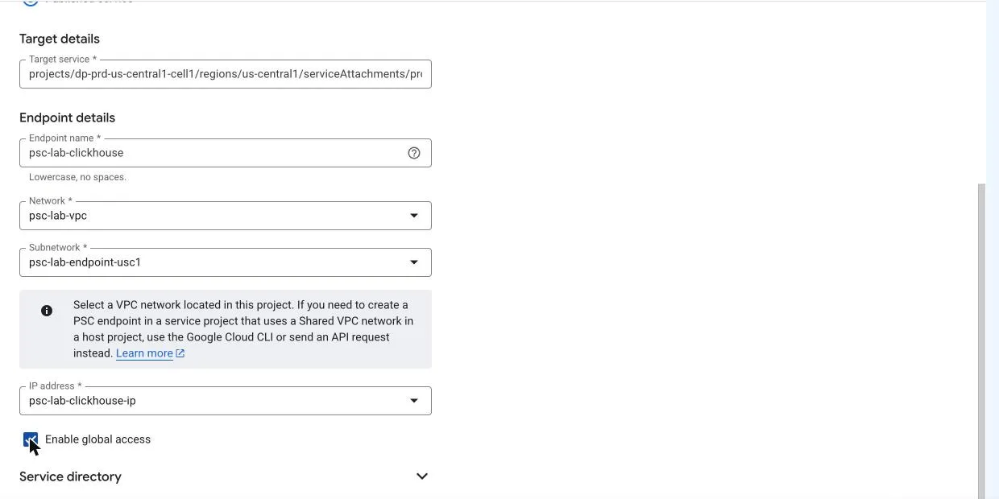
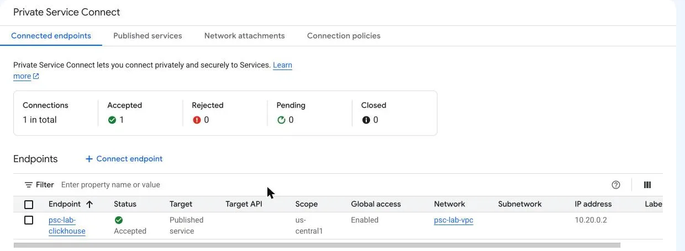
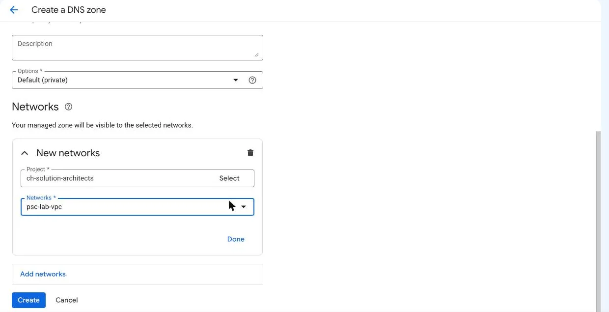
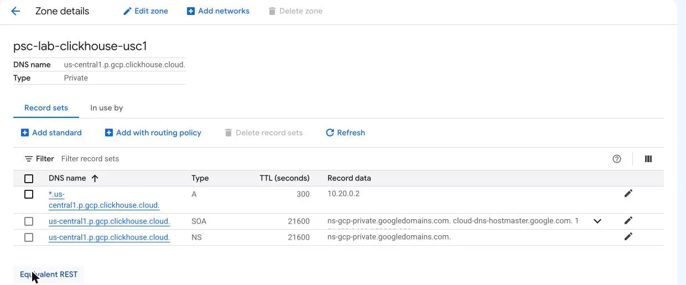
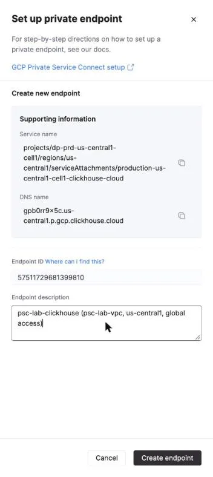
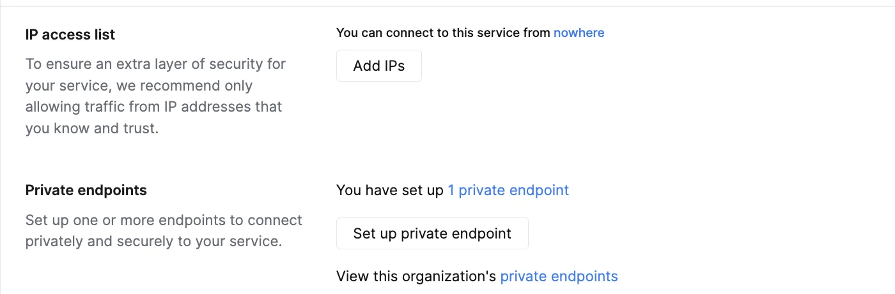

# Vector on GKE → ClickHouse Cloud over Private Service Connect, API allow list

[English](#english) | [한국어](#한국어)

## English

Verified on GKE 1.36.4 in asia-northeast3-a (private nodes, egress through Cloud NAT), ClickHouse Cloud on GCP us-central1 (ClickHouse 26.6), Vector 0.44.0 (Helm chart 0.40.0) and Loki 3.7.9, 2026-11-18.

**The question.** A GKE team already runs Vector 0.44 as an Agent: Kong gateway logs (nginx-style text) are parsed with grok and sent to Loki, every other pod log goes to Loki as is. They want to send *some* APIs (`band`, `home`, `live`, `catalog`, `search`) to ClickHouse Cloud as well, from both Kong gateways and from the API pods, which log JSON or text depending on the pod. The nodes reach the internet through Cloud NAT, which would work, but they want the traffic on Private Service Connect (PSC) instead. Does the added branch leave Loki as it is, keep the other APIs out, and actually avoid Cloud NAT?

Follows [`../vector-route-dual-write`](../vector-route-dual-write) (local k3d, buffer modes during a ClickHouse outage).

### Layout

```
 GKE asia-northeast3 (psc-lab-vpc / 10.10.0.0/20)                    GCP us-central1
 ┌─────────────────────────────────────────────────────┐
 │ kong-proxy-external/internal ─┐                     │
 │ apps/<app> (json | text)  ────┤ Vector 0.44 (Agent) │
 │                               │  existing: → Loki   │      psc-lab-vpc / 10.20.0.0/24
 │                               │  added: allow list  │   ┌───────────────────────────┐
 │                               └──── HTTPS 8443 ─────┼──▶│ PSC endpoint 10.20.0.2    │──▶ ClickHouse Cloud
 │ Cloud DNS (private): *.<region>.p.gcp.clickhouse.cloud → 10.20.0.2 (global access) │    service attachment
 │ Cloud NAT: other internet egress — not used for ClickHouse                            │
 └───────────────────────────────────────────────────────────────────────────────────────┘
```

- [`vector/values-existing.yaml`](vector/values-existing.yaml): the existing config as the team runs it. Only the Kong app labels, the Loki endpoint, `cluster_name` and `podPriorityClassName` differ.
- [`vector/values-clickhouse.yaml`](vector/values-clickhouse.yaml): everything added. Helm merges it over the existing file, so nothing in the existing pipeline is edited: two remaps read the outputs the Loki sinks already read, two ClickHouse sinks write `logs.kong_access` and `logs.app_logs`. The allow lists are two env vars (`CH_KONG_APIS`, `CH_POD_APPS`), so adding an API is a values change.
- [`sql/schema.sql`](sql/schema.sql): the two tables, 90-day TTL. Not stored: client IP, X-Forwarded-For, the Azure client IP, the query string and the last Kong field.
- [`k8s/gen.py`](k8s/gen.py): log lines in the existing grok's format. Kong: 7 upstreams (5 allowed + `member`, `payment`) and one nginx error line per run. Apps: `band`, `home`, `catalog` JSON; `live`, `search` text; `member` (JSON with an e-mail and phone number) and `payment` not allowed.
- [`bin/lab.py`](bin/lab.py): `up`, `secrets`, `schema`, `ch`, `path`, `run <RUN> <N>`, `counts <RUN>`, `sql`, `metrics`, `down`. Credentials come from a local env file and go straight into Kubernetes Secrets.

### Private Service Connect, step by step

ClickHouse Cloud gives two values per service: the **service attachment** of its region and the **private DNS name** (`<id>.<region>.p.gcp.clickhouse.cloud`). Both are under the service's Settings → Private endpoints → *Set up private endpoint*, or from the API (`GET /v1/organizations/{org}/services/{id}/privateEndpointConfig`).

1. **Subnet in the service's region.** A PSC endpoint has to be in the region of the service attachment. The GKE subnet is in Seoul, so the VPC gets a second subnet in us-central1 (`10.20.0.0/24`) just for the endpoint. The console only offers subnets in that region.
2. **Endpoint.** Network services → Private Service Connect → *Connect endpoint*: target *Published service*, the service attachment, a name, the VPC, the us-central1 subnet, a new reserved internal IP, and **Enable global access**. Global access is what lets pods in Seoul use an endpoint in us-central1.

   

   The connection shows *Accepted* within seconds. Its **PSC connection ID** (`gcloud compute forwarding-rules describe <name> --region us-central1 --format='value(pscConnectionId)'`) is what ClickHouse Cloud asks for.

   

3. **Private DNS.** Cloud DNS → *Create a DNS zone*: Private, DNS name `us-central1.p.gcp.clickhouse.cloud`, visible to the VPC. Add an A record `*.us-central1.p.gcp.clickhouse.cloud` → the endpoint IP. One wildcard record covers every service in that region. <!-- gitleaks:allow -->

   

   

4. **ClickHouse Cloud.** Service → Settings → *Set up private endpoint*: paste the PSC connection ID as the Endpoint ID.

   

5. **Close the public path.** Remove every entry from the service's IP access list. The service then answers only through the private endpoint.

   

6. **Vector.** `endpoint: https://<id>.us-central1.p.gcp.clickhouse.cloud:8443` (the private name, not the public one) and a user with INSERT on the two tables only. <!-- gitleaks:allow -->

### Run

```bash
export LAB_ENV=~/.config/khai-harness/secrets/psc-lab.env   # CH_PRIVATE_HOST, CH_PUBLIC_HOST, CH_ADMIN_USER, CH_ADMIN_PASSWORD
bin/lab.py up          # Loki, emitters, toolbox, Vector with the existing config only
bin/lab.py secrets     # clickhouse-admin (toolbox), clickhouse-ingest (vector)
bin/lab.py schema      # tables + vector_ingest
bin/lab.py ch          # Vector with values-existing.yaml + values-clickhouse.yaml
bin/lab.py path        # DNS and HTTPS from a pod: private and public names
bin/lab.py run R9 100 && sleep 30 && bin/lab.py counts R9
bin/lab.py down
```

### Results (2026-11-18)

**Path** ([`results/path-psc.txt`](results/path-psc.txt)). From a pod in Seoul the private name resolves to `10.20.0.2` and answers. With the IP access list empty, the public name (via Cloud NAT) fails at TLS. Cloud NAT's log has no connection to the service's public IP other than the toolbox checks; none from Vector. A new HTTPS connection over PSC takes 175 ms to connect and 355 ms to finish TLS (Seoul to Iowa); `SELECT 1` completes in 530 ms. Vector keeps its connections open, so this is paid once per connection, not per batch.

**Routing** ([`results/routing-R9.txt`](results/routing-R9.txt)). One run = 100 lines per upstream per Kong pod (701 lines with the error line) and 100 lines per app pod.

| | ClickHouse | Loki |
|---|---|---|
| kong-proxy-external | 500: band, catalog, home, live, search × 100 | 701 |
| kong-proxy-internal | 500, same split | 701 |
| `member`, `payment` upstreams, nginx error line | 0 | included above |
| app pods on the list (3 JSON, 2 text) | 500: 100 each, `Format` json / text | 100 each |
| `member`, `payment` pods | 0 | 100 each |

Runs R2–R9: 1,000 Kong rows and 500 app rows every time (R4 was N = 10: 100 / 50). Over all 8,100 Kong rows and 4,050 app rows: no query string, no `member` or `payment`, no e-mail address. Upstream times logged as `-` are `NULL`.

**A disk buffer held 300 events** ([`results/disk-buffer-stall-R1.txt`](results/disk-buffer-stall-R1.txt)). On the first run after the ClickHouse branch was added, one Vector pod kept 300 app rows (about 100 KB) in the `ch_app` disk buffer: `vector_buffer_events` stayed at 300 for more than two minutes while the same pod's `ch_kong` sink sent everything. They arrived when the pods were restarted. Not seen in the eight runs after that. The same happened once with Vector 0.44.0 in Docker on a laptop. Watch `vector_buffer_events` for the ClickHouse sinks: a value that stays above zero while no new rows arrive is this case.

Other things seen on the way:

- Vector 0.61.0 does not start with this config: `api.playground` is no longer a known field. With it removed, 0.61.0 still refused `endpoint: "${CH_ENDPOINT}"` (`invalid uri character`). An upgrade needs both looked at; 0.61 was not run further here.
- ClickHouse Cloud rejects a password without 12 characters, a digit, an upper-case letter and a special character (`CREATE USER` fails with `BAD_ARGUMENTS`).
- The emitter's Kong timestamps first used the pod clock (UTC) with a `+0900` suffix, which put them 9 hours in the past: Vector parses `time_local` into the event time, so Loki filed them outside a 6-hour query. Real gateways write their own offset; `gen.py` now uses KST.
- Cloud NAT logged no connection for the image pulls (Docker Hub images: Python, curl, Loki, Vector). GKE's own Docker Hub mirror is the likely reason; not checked further.

### Data transfer

On the NAT path, Cloud NAT bills data processing per GiB in both directions on top of internet egress. On the PSC path there is no NAT and no internet egress: the endpoint has an hourly charge and PSC consumer data processing. When GKE and the service are in different regions (here Seoul and us-central1), GCP inter-region transfer applies on the PSC path too. Rates: [Cloud NAT pricing](https://cloud.google.com/nat/pricing), [VPC pricing: Private Service Connect](https://cloud.google.com/vpc/pricing), [network pricing](https://cloud.google.com/vpc/network-pricing).

### Not covered

Real Kong pods (the emitter writes the same text format), Shared VPC (the endpoint is in the same project as the VPC), ClickHouse outages on GKE (see the k3d lab), several GKE clusters sharing one endpoint, and Vector versions after 0.44.

## 한국어

2026-11-18 GKE 1.36.4 asia-northeast3-a(private nodes, Cloud NAT로 외부 송신), ClickHouse Cloud GCP us-central1(ClickHouse 26.6), Vector 0.44.0(Helm chart 0.40.0), Loki 3.7.9로 검증했습니다.

**질문.** GKE에서 Vector 0.44를 Agent로 이미 운영 중입니다. Kong gateway 로그(nginx 형식 텍스트)는 grok으로 파싱해 Loki로, 나머지 Pod 로그는 그대로 Loki로 보냅니다. 여기에 *일부* API(`band`, `home`, `live`, `catalog`, `search`)만 두 Kong gateway와 API Pod(Pod마다 JSON 또는 텍스트)에서 ClickHouse Cloud로도 보내려 합니다. 노드는 Cloud NAT로 인터넷에 나가므로 그대로도 되지만, 이 트래픽은 Private Service Connect(PSC)로 보내고 싶습니다. 추가한 분기가 Loki를 그대로 두는지, 다른 API는 빠지는지, 실제로 Cloud NAT를 안 타는지 확인합니다.

[`../vector-route-dual-write`](../vector-route-dual-write)(로컬 k3d, ClickHouse 장애 시 버퍼 동작)에 이어지는 실습입니다.

### 구성

- [`vector/values-existing.yaml`](vector/values-existing.yaml): 운영 중인 기존 설정. Kong app 라벨, Loki 주소, `cluster_name`, `podPriorityClassName`만 다릅니다.
- [`vector/values-clickhouse.yaml`](vector/values-clickhouse.yaml): 추가분 전체. Helm이 기존 파일 위에 합치므로 기존 파이프라인은 한 줄도 고치지 않습니다. remap 둘이 Loki sink가 이미 읽는 출력을 같이 읽고, ClickHouse sink 둘이 `logs.kong_access`·`logs.app_logs`에 씁니다. 허용 목록은 환경 변수 둘(`CH_KONG_APIS`, `CH_POD_APPS`)이라 API 추가는 values 변경입니다.
- [`sql/schema.sql`](sql/schema.sql): 테이블 둘, 90일 TTL. 클라이언트 IP, X-Forwarded-For, Azure 클라이언트 IP, 쿼리스트링, Kong 마지막 필드는 저장하지 않습니다.
- [`k8s/gen.py`](k8s/gen.py): 기존 grok 형식의 로그. Kong은 upstream 7개(허용 5개 + `member`, `payment`)와 실행마다 nginx 에러 한 줄. 앱은 `band`, `home`, `catalog` JSON, `live`, `search` 텍스트, 허용 목록 밖의 `member`(이메일·전화번호가 든 JSON)와 `payment`.
- [`bin/lab.py`](bin/lab.py): `up`, `secrets`, `schema`, `ch`, `path`, `run <RUN> <N>`, `counts <RUN>`, `sql`, `metrics`, `down`. 자격 증명은 로컬 env 파일에서 Kubernetes Secret으로 바로 들어갑니다.

### Private Service Connect 설정 순서

ClickHouse Cloud는 서비스마다 두 값을 줍니다. 리전의 **service attachment**와 **사설 DNS 이름**(`<id>.<region>.p.gcp.clickhouse.cloud`)입니다. 서비스 Settings → Private endpoints → *Set up private endpoint* 화면이나 API(`GET /v1/organizations/{org}/services/{id}/privateEndpointConfig`)에서 볼 수 있습니다.

1. **서비스 리전에 서브넷.** PSC 엔드포인트는 service attachment와 같은 리전에 있어야 합니다. GKE 서브넷은 서울이라 VPC에 엔드포인트 전용 us-central1 서브넷(`10.20.0.0/24`)을 하나 더 둡니다. 콘솔도 그 리전 서브넷만 보여 줍니다.
2. **엔드포인트.** Network services → Private Service Connect → *Connect endpoint*: 대상 *Published service*, service attachment, 이름, VPC, us-central1 서브넷, 새로 예약한 내부 IP, 그리고 **Enable global access**. global access가 있어야 서울 Pod가 us-central1 엔드포인트를 씁니다. 몇 초 안에 *Accepted*가 되고, ClickHouse Cloud에 넣을 값은 **PSC connection ID**(`gcloud compute forwarding-rules describe <name> --region us-central1 --format='value(pscConnectionId)'`)입니다.
3. **사설 DNS.** Cloud DNS → *Create a DNS zone*: Private, DNS 이름 `us-central1.p.gcp.clickhouse.cloud`, 대상 VPC. A 레코드 `*.us-central1.p.gcp.clickhouse.cloud` → 엔드포인트 IP. 와일드카드 하나로 그 리전의 서비스 전부를 덮습니다. <!-- gitleaks:allow -->
4. **ClickHouse Cloud.** 서비스 → Settings → *Set up private endpoint*에 PSC connection ID를 Endpoint ID로 넣습니다.
5. **공용 경로 닫기.** 서비스 IP access list를 비웁니다. 그러면 사설 엔드포인트로만 응답합니다.
6. **Vector.** `endpoint: https://<id>.us-central1.p.gcp.clickhouse.cloud:8443`(공용 이름이 아니라 사설 이름), 두 테이블에 INSERT만 있는 사용자. <!-- gitleaks:allow -->

화면은 위 English 절의 그림과 같습니다.

### 결과 (2026-11-18)

**경로** ([`results/path-psc.txt`](results/path-psc.txt)). 서울 Pod에서 사설 이름은 `10.20.0.2`로 풀리고 응답합니다. IP access list를 비우면 공용 이름(Cloud NAT 경유)은 TLS 단계에서 실패합니다. Cloud NAT 로그에는 toolbox 확인 외에 서비스 공용 IP로 간 연결이 없고, Vector가 만든 연결은 하나도 없습니다. PSC로 새 HTTPS 연결은 TCP 175 ms, TLS까지 355 ms(서울–아이오와), `SELECT 1`은 530 ms입니다. Vector는 연결을 유지하므로 배치마다가 아니라 연결마다 한 번 드는 시간입니다.

**분기** ([`results/routing-R9.txt`](results/routing-R9.txt)). 한 번 실행 = Kong Pod마다 upstream별 100줄(에러 줄 포함 701줄), 앱 Pod마다 100줄.

| | ClickHouse | Loki |
|---|---|---|
| kong-proxy-external | 500: band, catalog, home, live, search × 100 | 701 |
| kong-proxy-internal | 500, 같은 구성 | 701 |
| `member`, `payment` upstream, nginx 에러 줄 | 0 | 위에 포함 |
| 허용 목록의 앱 Pod(JSON 3, 텍스트 2) | 500: 각 100, `Format` json / text | 각 100 |
| `member`, `payment` Pod | 0 | 각 100 |

R2–R9 실행마다 Kong 1,000행, 앱 500행(R4는 N = 10: 100 / 50). Kong 8,100행·앱 4,050행 전체에 쿼리스트링, `member`·`payment`, 이메일 주소가 없습니다. `-`로 찍힌 upstream 시간은 `NULL`입니다.

**디스크 버퍼에 300건이 남음** ([`results/disk-buffer-stall-R1.txt`](results/disk-buffer-stall-R1.txt)). ClickHouse 분기를 추가한 뒤 첫 실행에서 Vector Pod 하나가 앱 로그 300건(약 100 KB)을 `ch_app` 디스크 버퍼에 들고 있었습니다. 같은 Pod의 `ch_kong`은 전부 보냈는데 `vector_buffer_events`는 2분 넘게 300에 머물렀고, Pod를 재시작하자 들어왔습니다. 이후 여덟 번 실행에서는 다시 나오지 않았습니다. 노트북 Docker의 Vector 0.44.0에서도 한 번 있었습니다. ClickHouse sink의 `vector_buffer_events`가 새 행이 없는데 0보다 큰 채로 머물면 이 경우입니다.

그 밖에 본 것:

- Vector 0.61.0은 이 설정으로 뜨지 않습니다. `api.playground`가 더 이상 없는 항목이고, 이를 빼도 `endpoint: "${CH_ENDPOINT}"`를 `invalid uri character`로 거부했습니다. 올릴 때 두 가지를 봐야 합니다. 0.61은 더 돌리지 않았습니다.
- ClickHouse Cloud는 12자 이상, 숫자, 대문자, 특수문자가 없는 비밀번호를 거부합니다(`CREATE USER`가 `BAD_ARGUMENTS`).
- 생성기의 Kong 시각이 처음에는 Pod 시계(UTC)에 `+0900`을 붙여 9시간 과거였습니다. Vector가 `time_local`을 이벤트 시각으로 쓰므로 Loki 6시간 조회에서 빠졌습니다. 실제 gateway는 자기 오프셋을 쓰며, `gen.py`는 이제 KST를 씁니다.
- 이미지 pull(Docker Hub의 Python, curl, Loki, Vector)은 Cloud NAT 로그에 없었습니다. GKE 자체 Docker Hub 미러 때문으로 보이며 더 확인하지 않았습니다.

### 데이터 전송

NAT 경로에서는 인터넷 송신에 더해 Cloud NAT가 양방향 처리량(GiB)에 과금합니다. PSC 경로에는 NAT도 인터넷 송신도 없고, 엔드포인트 시간당 요금과 PSC 소비자 데이터 처리 요금이 붙습니다. GKE와 서비스 리전이 다르면(여기서는 서울과 us-central1) PSC 경로에도 GCP 리전 간 전송 요금이 붙습니다. 단가: [Cloud NAT pricing](https://cloud.google.com/nat/pricing), [VPC pricing: Private Service Connect](https://cloud.google.com/vpc/pricing), [network pricing](https://cloud.google.com/vpc/network-pricing).

### 다루지 않은 것

실제 Kong Pod(생성기가 같은 텍스트 형식을 씀), Shared VPC(엔드포인트가 VPC와 같은 프로젝트), GKE에서의 ClickHouse 장애(k3d 실습 참고), 여러 GKE 클러스터가 엔드포인트 하나를 공유하는 구성, 0.44 이후 Vector 버전.
