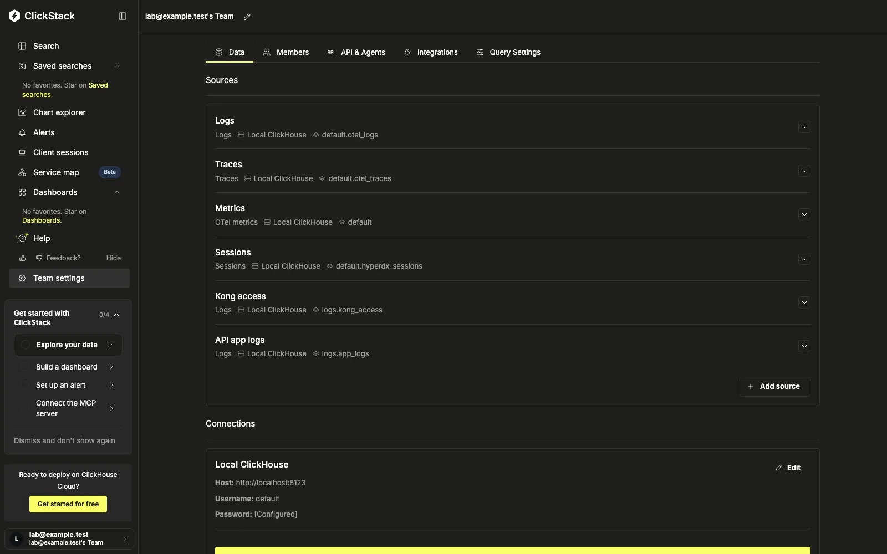
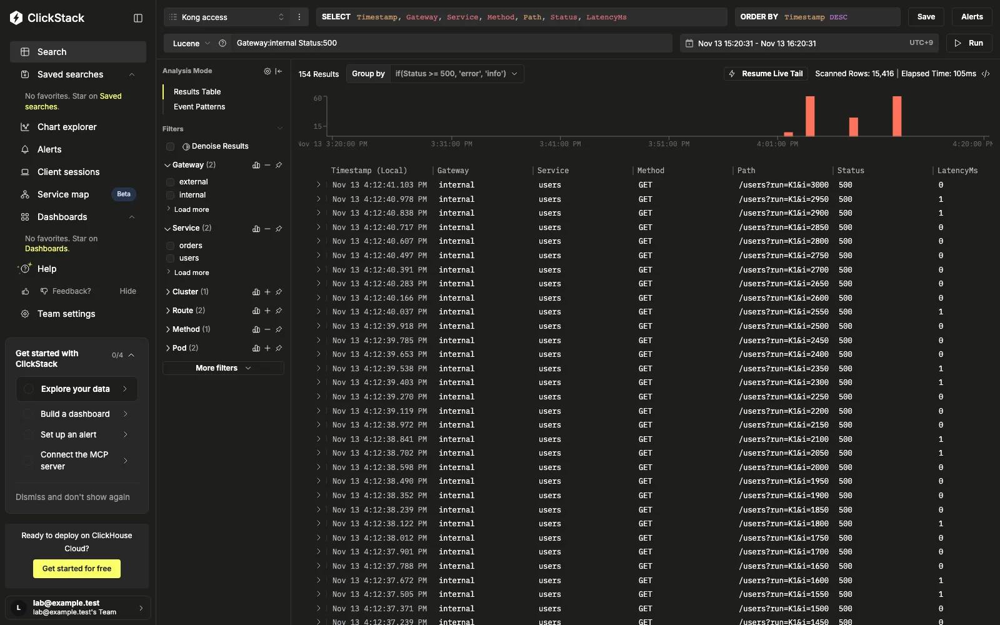
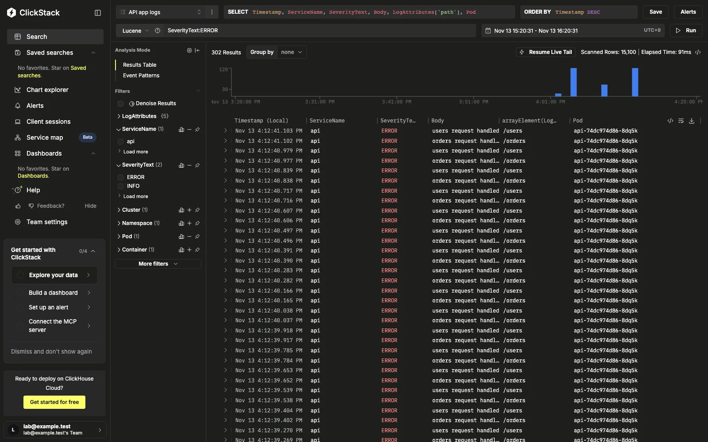

# Vector → ClickStack next to an existing Loki pipeline

[English](#english) | [한국어](#한국어)

## English

Verified on Vector 0.61.0 (Helm chart 0.61.0), clickstack-all-in-one 2.44.0 (ClickHouse 26.8.36.3), Loki 3.7.9, Kong 3.9.4, on k3d (k3s v1.35.5), 2026-11-13.

**The question.** Vector already ships every Kubernetes log to Loki. Can the same Vector also send *some* workloads to ClickHouse, into their own tables, while the Loki path stays as it is? What happens to Loki while ClickHouse is down? Here two Kong gateways (`kong-external`, `kong-internal`) and one API deployment are the workloads to route. A traffic generator stands in for everything else.

### Layout

```
        kubernetes_logs (k8s)  ── every pod on the node
         │                    │
         │ (existing)         │ (added)
         ▼                    ▼
   loki_labels ─▶ loki   by_workload (route)
                          ├─ kong_external ─┐
                          ├─ kong_internal ─┴▶ kong_rows (remap) ─▶ ch_kong ─▶ logs.kong_access
                          ├─ api ─────────────▶ api_rows  (remap) ─▶ ch_app  ─▶ logs.app_logs
                          └─ _unmatched        (no consumer: Loki only)
```

- [`vector/values.yaml`](vector/values.yaml): the whole Vector config. The Loki half stays as it was. The route, the two remaps and the two ClickHouse sinks are the additions.
- [`vector/mode-*.yaml`](vector/): the ClickHouse sinks' buffer. `block` is the default `when_full`; `drop` uses `drop_newest`; `disk` uses a 256 MiB disk buffer with `drop_newest`. The Loki sink keeps Vector's default buffer in every mode.
- [`sql/schema.sql`](sql/schema.sql): `logs.kong_access` (gateway fields as columns, `Gateway` = external/internal, `Cluster`) and `logs.app_logs` (JSON unpacked, a non-JSON line kept whole in `Body`).
- [`k8s/`](k8s/): Loki, ClickStack (one PVC for ClickHouse and the UI's MongoDB), two Kong Deployments with the same DB-less config told apart by the pod label `app`, and the API.
- [`bin/lab.py`](bin/lab.py): `up`, `mode`, `run <RUN> <N>` (N requests to each gateway, tagged `run=<RUN>`), `counts`, `outage`, `down`.

### Run

```bash
bin/lab.py up                       # k3d cluster, backends, workloads, schema, Vector (block)
bin/lab.py run R3 300 && sleep 20 && bin/lab.py counts R3
bin/lab.py outage block B3 3000     # ClickStack scaled to 0, 3,000 requests, 2 min, back up
bin/lab.py outage drop  D2 3000
bin/lab.py outage disk  K1 3000
bin/lab.py down
```

The UI is at `kubectl --context k3d-vector-lab -n clickstack port-forward svc/clickstack 8080:8080`. Use port 8080: after login the UI redirects to `localhost:8080`.

### Results (2026-11-13)

**Routing and dual write** ([`results/routing-R3.txt`](results/routing-R3.txt)): 300 requests to each gateway.

| | ClickHouse | Loki |
|---|---|---|
| kong-external | 300 (`Gateway = external`) | 300 |
| kong-internal | 300 (`Gateway = internal`) | 300 |
| API (one line per request) | 600 (12 `ERROR`, 588 `INFO`) | 600 |
| traffic generator (unmatched) | 0 in either table | 300 |

Each gateway had 6 responses with status 500, as designed (every 50th request).

**ClickHouse down for about 2 minutes**: 3,000 requests to each gateway, so 6,000 rows per ClickHouse sink. Logs: [`results/outage-*.txt`](results/).

| ClickHouse sink buffer | Loki during the outage | ClickHouse after recovery | Discarded |
|---|---|---|---|
| memory 500, `block` (default) | **stopped** at 1,959 of 3,000 for 124 s. The unrelated generator's logs stopped too | 6,000 / 6,000 kong, 6,000 / 6,000 API, 31 s after restart | 0 |
| memory 500, `drop_newest` | complete (3,000 / 3,000) within 20 s | 2,816 / 6,000 kong, 2,500 / 6,000 API | 3,184 + 3,500, exactly the shortfall |
| disk 256 MiB, `drop_newest` | complete within 20 s | 6,000 / 6,000 kong, 6,000 / 6,000 API, 31 s after restart | 0 |

What this shows:

1. **`block` stops the whole source, not just the ClickHouse branch.** Loki got nothing new for as long as ClickHouse was down, including logs from pods that never go to ClickHouse. Nothing was lost in this run, because `kubernetes_logs` resumes from its file checkpoints. The cost is a Loki gap for the length of the outage. Log rotation during a long outage was not tested.
2. **`drop_newest` keeps Loki whole and sacrifices ClickHouse.** `vector_buffer_discarded_events_total` counted exactly what ClickHouse was missing.
3. **A disk buffer gives both** for as long as it lasts. The 6,000 gateway rows took 13.4 MB in the buffer (about 2.2 KB per row, raw line included), so 256 MiB holds about 120,000 such rows. That figure is computed, not measured: hold time = buffer size ÷ the routed rate.

**One bad row drops the whole batch.** On the first run, Kong 3.9.4 logged `latencies.proxy = -3` for one request. The table had `UInt32`, so ClickHouse rejected the 1,000-row insert (`CANNOT_PARSE_NUMBER`, HTTP 400). Vector treats a 400 as not retriable and dropped all 1,000 rows (`vector_component_discarded_events_total{intentional="false"}`, [`results/outage-drop-D1-uint-schema.txt`](results/outage-drop-D1-uint-schema.txt)). The latency columns are now `Int32`. Watch that counter, not only the buffer counters.

Other things seen on the way:

- A new pod's log file can take up to `glob_minimum_cooldown_ms` (default 60,000 ms) to be picked up; the lab sets 5,000.
- Helm passes `customConfig` through `tpl`, so Vector's `{{ field }}` templates must be written `{{ "{{" }} field {{ "}}" }}`.
- `async_insert` is on by default in this ClickHouse build (`system.settings`: `async_insert = 1`, `changed = 0`). Vector's 1,000-row batches went through it.

**ClickStack.** Both tables are ordinary log sources. `app_logs` (OTel-like column names) was inferred automatically. For `kong_access`, the timestamp, service (`Service`), body and log level (`if(Status >= 500, 'error', 'info')`) were set by hand.







### Not covered

GCP Private Service Connect, ClickHouse Cloud regions and cross-region latency, a dedicated insert-only user (the lab uses the image's `api` user), and log rotation during long outages.

## 한국어

2026-11-13 k3d(k3s v1.35.5)에서 Vector 0.61.0(Helm chart 0.61.0), clickstack-all-in-one 2.44.0(ClickHouse 26.8.36.3), Loki 3.7.9, Kong 3.9.4로 검증했습니다.

**질문.** Vector가 이미 모든 Kubernetes 로그를 Loki로 보내고 있습니다. 같은 Vector가 Loki 경로는 그대로 둔 채 *일부* 워크로드만 ClickHouse의 전용 테이블로도 보낼 수 있을까요? ClickHouse가 내려가 있는 동안 Loki는 어떻게 될까요? 여기서는 Kong gateway 두 개(`kong-external`, `kong-internal`)와 API Deployment 하나를 분기 대상으로 둡니다. 그 밖의 모든 워크로드는 트래픽 생성기가 대신합니다.

### 구성

```
        kubernetes_logs (k8s)  ── 노드의 모든 파드
         │                    │
         │ (기존)             │ (추가)
         ▼                    ▼
   loki_labels ─▶ loki   by_workload (route)
                          ├─ kong_external ─┐
                          ├─ kong_internal ─┴▶ kong_rows (remap) ─▶ ch_kong ─▶ logs.kong_access
                          ├─ api ─────────────▶ api_rows  (remap) ─▶ ch_app  ─▶ logs.app_logs
                          └─ _unmatched        (소비자 없음: Loki에만 감)
```

- [`vector/values.yaml`](vector/values.yaml): Vector 설정 전체. Loki 쪽은 원래 그대로입니다. route, remap 둘, ClickHouse sink 둘이 추가한 부분입니다.
- [`vector/mode-*.yaml`](vector/): ClickHouse sink의 버퍼. `block`은 기본 `when_full`이고, `drop`은 `drop_newest`, `disk`는 256 MiB 디스크 버퍼에 `drop_newest`입니다. Loki sink는 어느 모드에서나 Vector 기본 버퍼를 씁니다.
- [`sql/schema.sql`](sql/schema.sql): `logs.kong_access`(gateway 필드를 컬럼으로, `Gateway` = external/internal, `Cluster`)와 `logs.app_logs`(JSON을 펼침, JSON이 아닌 줄은 `Body`에 그대로).
- [`k8s/`](k8s/): Loki, ClickStack(ClickHouse와 UI의 MongoDB가 PVC 하나를 씀), 같은 DB-less 설정을 쓰고 파드 라벨 `app`으로만 구분되는 Kong Deployment 둘, API.
- [`bin/lab.py`](bin/lab.py): `up`, `mode`, `run <RUN> <N>`(gateway마다 요청 N개, `run=<RUN>` 표시), `counts`, `outage`, `down`.

### 실행

```bash
bin/lab.py up                       # k3d 클러스터, 백엔드, 워크로드, 스키마, Vector(block)
bin/lab.py run R3 300 && sleep 20 && bin/lab.py counts R3
bin/lab.py outage block B3 3000     # ClickStack을 0으로 줄이고 요청 3,000개, 2분 뒤 다시 올림
bin/lab.py outage drop  D2 3000
bin/lab.py outage disk  K1 3000
bin/lab.py down
```

UI는 `kubectl --context k3d-vector-lab -n clickstack port-forward svc/clickstack 8080:8080`으로 엽니다. 포트는 8080이어야 합니다. 로그인 뒤 UI가 `localhost:8080`으로 보냅니다.

### 결과 (2026-11-13)

**분기와 이중 적재** ([`results/routing-R3.txt`](results/routing-R3.txt)): gateway마다 요청 300개.

| | ClickHouse | Loki |
|---|---|---|
| kong-external | 300 (`Gateway = external`) | 300 |
| kong-internal | 300 (`Gateway = internal`) | 300 |
| API (요청마다 한 줄) | 600 (`ERROR` 12, `INFO` 588) | 600 |
| 트래픽 생성기(분기 안 됨) | 두 테이블 모두 0 | 300 |

gateway마다 상태 500 응답이 6개씩이었습니다. 설계대로 50번째 요청마다 하나입니다.

**ClickHouse를 약 2분 내림**: gateway마다 요청 3,000개, 즉 ClickHouse sink마다 6,000행. 로그: [`results/outage-*.txt`](results/).

| ClickHouse sink 버퍼 | 장애 중 Loki | 복구 뒤 ClickHouse | 버린 건수 |
|---|---|---|---|
| memory 500, `block`(기본값) | 3,000 중 1,959에서 124초 동안 **멈춤**. 관계없는 생성기 로그도 함께 멈춤 | 다시 올린 뒤 31초 만에 kong 6,000 / 6,000, API 6,000 / 6,000 | 0 |
| memory 500, `drop_newest` | 20초 안에 전량(3,000 / 3,000) | kong 2,816 / 6,000, API 2,500 / 6,000 | 3,184 + 3,500, 모자란 만큼과 정확히 같음 |
| disk 256 MiB, `drop_newest` | 20초 안에 전량 | 다시 올린 뒤 31초 만에 kong 6,000 / 6,000, API 6,000 / 6,000 | 0 |

알 수 있는 것:

1. **`block`은 ClickHouse 분기만이 아니라 source 전체를 멈춥니다.** ClickHouse가 내려가 있는 동안 Loki에 새 로그가 하나도 들어가지 않았고, ClickHouse로 가지 않는 파드의 로그도 마찬가지였습니다. 이번 실행에서 유실은 없었습니다. `kubernetes_logs`가 파일 체크포인트에서 이어 읽기 때문입니다. 대가는 장애가 이어진 시간만큼 Loki에 생기는 공백입니다. 장애가 길어 로그가 rotation되는 경우는 시험하지 않았습니다.
2. **`drop_newest`는 Loki를 지키고 ClickHouse 쪽을 버립니다.** `vector_buffer_discarded_events_total`이 ClickHouse에서 모자란 건수를 정확히 셌습니다.
3. **디스크 버퍼는 버티는 동안 둘 다 지킵니다.** gateway 6,000행이 버퍼에서 13.4 MB를 차지했습니다(원본 줄 포함 행당 약 2.2 KB). 그러면 256 MiB에는 이런 행이 약 12만 개 들어갑니다. 이 값은 잰 것이 아니라 계산한 것입니다. 버티는 시간 = 버퍼 크기 ÷ 분기되는 초당 양.

**잘못된 행 하나가 배치 전체를 버리게 합니다.** 첫 실행에서 Kong 3.9.4가 요청 하나에 `latencies.proxy = -3`을 남겼습니다. 테이블 컬럼이 `UInt32`라 ClickHouse가 1,000행 insert를 거부했습니다(`CANNOT_PARSE_NUMBER`, HTTP 400). Vector는 400을 재시도하지 않는 오류로 보고 1,000행을 모두 버렸습니다(`vector_component_discarded_events_total{intentional="false"}`, [`results/outage-drop-D1-uint-schema.txt`](results/outage-drop-D1-uint-schema.txt)). 지금은 지연 컬럼을 `Int32`로 바꿨습니다. 버퍼 지표만 보지 말고 이 카운터도 봐야 합니다.

그 밖에 확인한 것:

- 새 파드의 로그 파일은 `glob_minimum_cooldown_ms`(기본 60,000 ms)만큼 늦게 읽힐 수 있습니다. 실습에서는 5,000으로 줄였습니다.
- Helm은 `customConfig`를 `tpl`로 처리합니다. 그래서 Vector의 `{{ field }}` 템플릿을 `{{ "{{" }} field {{ "}}" }}`로 써야 합니다.
- 이 ClickHouse 빌드는 `async_insert`가 기본으로 켜져 있습니다(`system.settings`: `async_insert = 1`, `changed = 0`). Vector의 1,000행 배치도 이 경로로 들어갔습니다.

**ClickStack.** 두 테이블 모두 일반 로그 소스로 등록됩니다. `app_logs`는 OTel과 비슷한 컬럼 이름이라 설정이 자동으로 채워졌습니다. `kong_access`는 timestamp, service(`Service`), body, log level(`if(Status >= 500, 'error', 'info')`)을 직접 넣었습니다.


### 다루지 않은 것

GCP Private Service Connect, ClickHouse Cloud 리전과 리전 간 지연, insert 전용 사용자(실습은 이미지의 `api` 사용자를 씀), 장애가 길 때의 로그 rotation.
